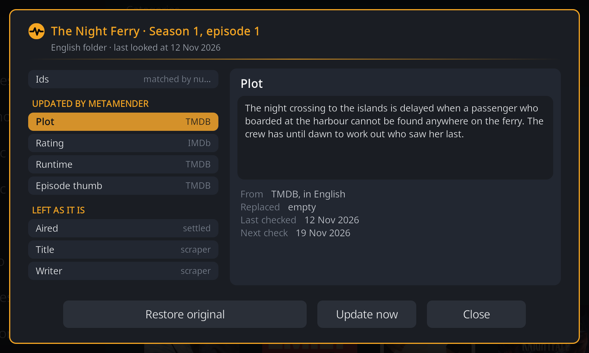

  <picture>
    <source media="(prefers-color-scheme: dark)" srcset="docs/assets/wordmark-on-dark.png">
    
  </picture>

<strong>No gaps. No stale scores. Age ratings you can trust.</strong>

MetaMender is a Kodi add-on that quietly improves your video library in the
background:

- **Gaps get filled.** Missing plots, episode titles, credits, taglines and
  more come from TMDB and TheTVDB, in each library's own language.
- **Scores that keep up.** A new episode's score is checked again while its
  votes come in, instead of staying at its first-week number forever.
- **Age ratings you can trust.** Movies and shows get their age rating in
  your own country's system, for ten countries.
- **Art, if you want it.** Washed-out frame grabs and broken episode thumbs
  get the official still (TMDB, else TheTVDB). Posters, fanart, clear logos,
  key art and fanart.tv's landscape, banner, disc art, clear art and character
  art are filled and refreshed while a title is new, in your library's
  language, from TMDB and fanart.tv (you choose which is asked first); an
  empty image gets an English one when nothing better exists. Local image
  files stay, and so does art you change afterwards, but a local file you
  deleted is filled like empty art, once MetaMender can tell the share it
  lives on is reachable
  ([details](https://rouzax.github.io/script.metamender/docs/libraries/#if-you-delete-your-local-art-files)).
  A replaced image can be put back from the Details window.
- **Movie sets in your language, if you want them.** A set gets TMDB's name
  and plot for its collection in the library's language, and its art, and a
  duplicate set Kodi makes under the old name is merged into the renamed one.

It respects what is yours (items with an NFO file keep their values, and a
replaced value can be put back), and its Details window shows, for any item,
where each value came from and why a field was left alone.

  

## Install

1. Install **MetaMender** from **Settings > Add-ons > Install from repository >
   Kodi Add-on repository > Program add-ons**.
2. Follow the setup: a free TMDB API key, then the libraries MetaMender may
   work in and what it fills in each.

The [Rouzax repository](https://github.com/Rouzax/repository.rouzax/releases)
gets new versions first, before the official Kodi repository.

Requires Kodi 21 (Omega) or Kodi 22 (Piers). Full instructions:
[Install](https://rouzax.github.io/script.metamender/docs/install/).

## Documentation

**[rouzax.github.io/script.metamender](https://rouzax.github.io/script.metamender/)**,
including [where your data comes from](https://rouzax.github.io/script.metamender/docs/where-data-comes-from/)
and [troubleshooting](https://rouzax.github.io/script.metamender/docs/troubleshooting/).

## Data sources

Metadata comes from [TMDB](https://www.themoviedb.org) and
[TheTVDB](https://thetvdb.com), ratings also from IMDb's public data. Art for
movies, shows, seasons and movie sets comes from TMDB and
[fanart.tv](https://fanart.tv) (landscape, banner, disc art, clear art and
character art from fanart.tv only), episode thumbs from TMDB and TheTVDB. See
[where your data comes from](https://rouzax.github.io/script.metamender/docs/where-data-comes-from/#image-credits).

## Support

Found a problem or have an idea? [Open an issue](https://github.com/Rouzax/script.metamender/issues). Questions are welcome in the [Kodi forum thread](https://forum.kodi.tv/showthread.php?tid=389809).

Building tools that solve my own problems and sharing them in the hope they solve yours too. This one saves you hunting down missing plots and checking whether that 9.4 from opening week still holds.

## Licence

GPL-3.0-only. See [LICENSE.txt](LICENSE.txt).
