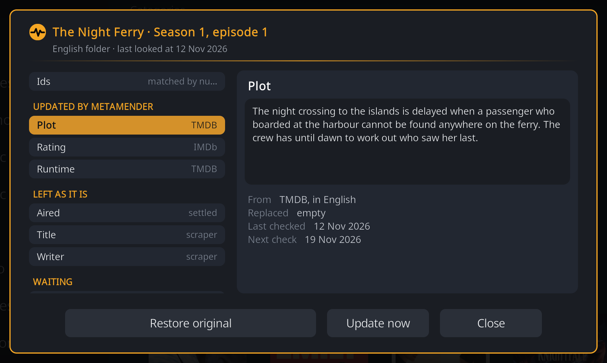

  <picture>
    <source media="(prefers-color-scheme: dark)" srcset="docs/assets/wordmark-on-dark.png">
    
  </picture>

<strong>No gaps. No stale scores. Age ratings you can trust.</strong>

MetaMender is a Kodi add-on that quietly improves your video library in the
background:

- **Gaps get filled.** Missing plots, episode titles, credits, taglines and
  more come from TMDB and TheTVDB, in each folder's own language.
- **Scores that keep up.** A new episode's score is checked again while its
  votes come in, instead of staying at its first-week number forever.
- **Age ratings you can trust.** Movies and shows get their age rating in
  your own country's system, for nine countries.

It respects what is yours (items with an NFO file keep their values, and a
replaced value can be put back), and its Details window shows, for any item,
where each value came from and why a field was left alone.

  

## Install

1. Install the [Rouzax repository](https://github.com/Rouzax/repository.rouzax/releases)
   with **Settings > Add-ons > Install from zip file**.
2. Install **MetaMender** from **Install from repository > Rouzax Repository**.
3. Follow the setup: a free TMDB API key, your library's languages, and what
   to fill.

Requires Kodi 21 (Omega) or Kodi 22 (Piers). Full instructions:
[Install](https://rouzax.github.io/script.metamender/docs/install/).

## Documentation

**[rouzax.github.io/script.metamender](https://rouzax.github.io/script.metamender/)**,
including [where your data comes from](https://rouzax.github.io/script.metamender/docs/where-data-comes-from/)
and [troubleshooting](https://rouzax.github.io/script.metamender/docs/troubleshooting/).

## Support

Found a problem or have an idea? [Open an issue](https://github.com/Rouzax/script.metamender/issues).

Building tools that solve my own problems and sharing them in the hope they solve yours too. This one saves you hunting down missing plots and checking whether that 9.4 from opening week still holds.

## Licence

GPL-3.0-only. See [LICENSE.txt](LICENSE.txt).
