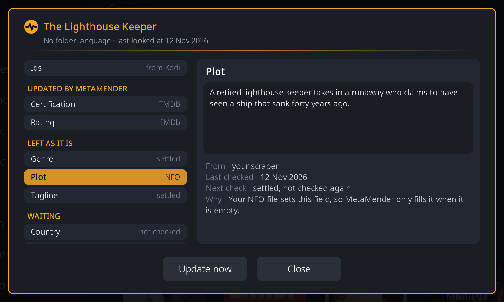
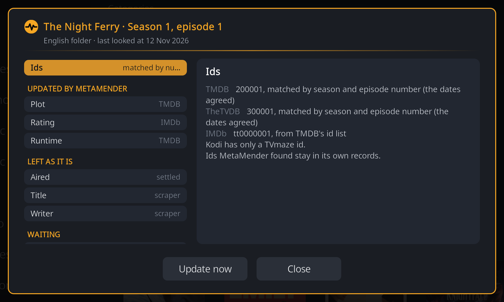
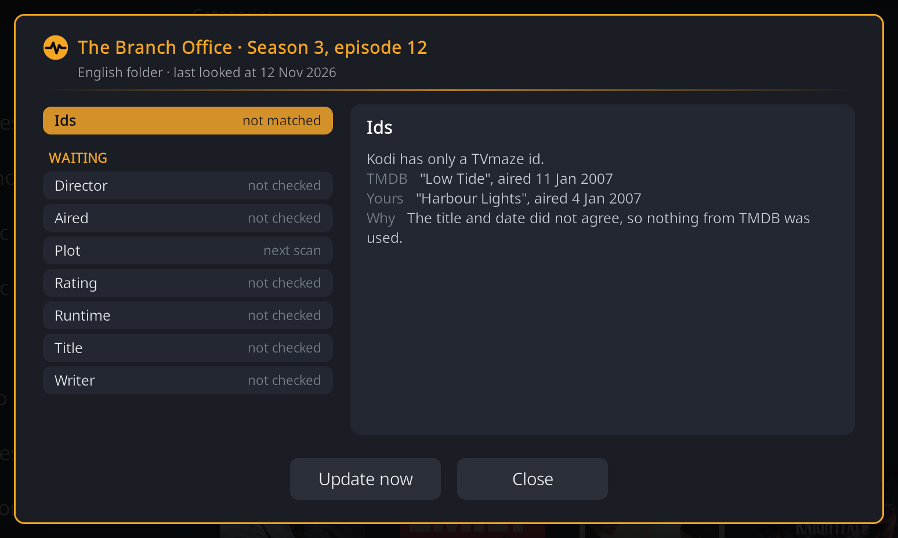
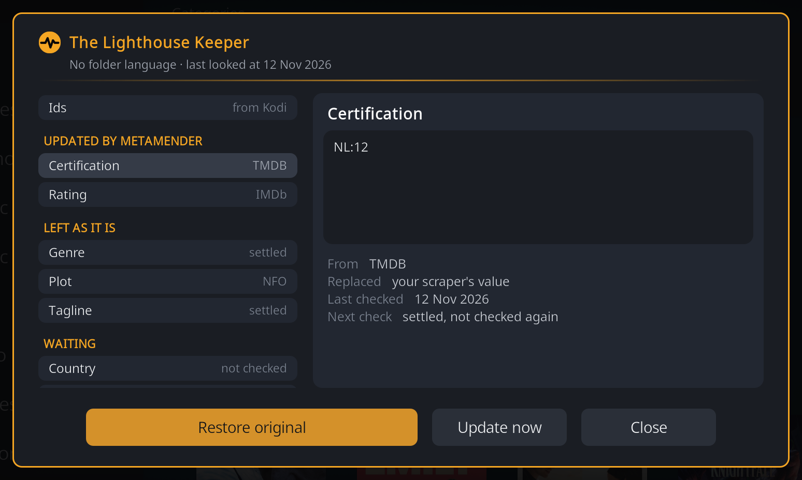
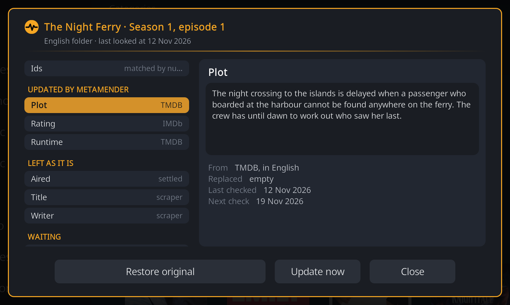
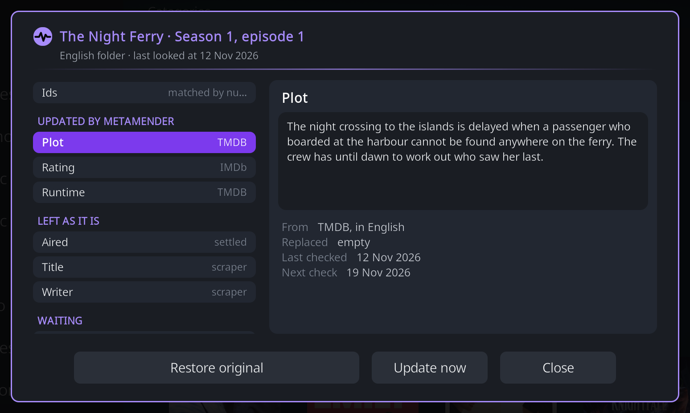
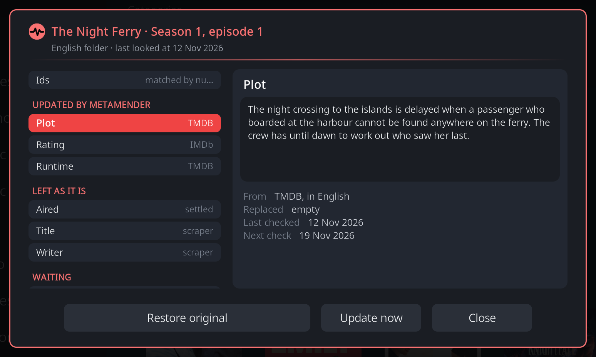
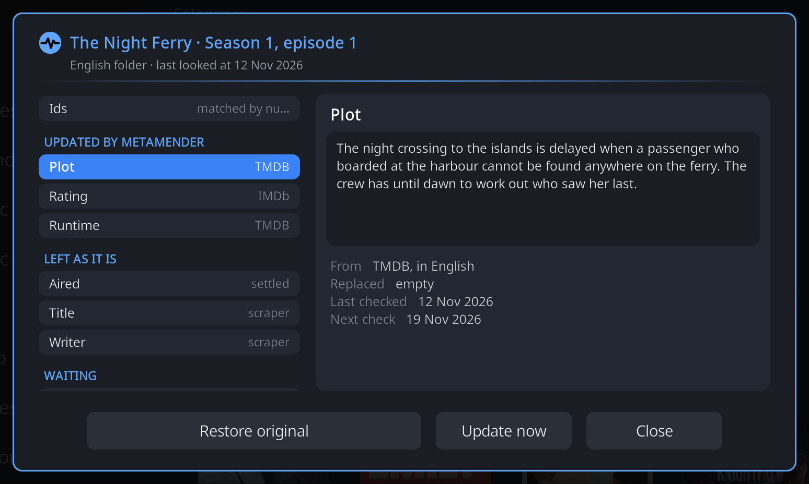

# The Details window

The Details window answers "why does this field look like this?" for one movie,
TV show or episode: where each value came from, what it replaced, when
MetaMender last checked it and when it checks again, and why it left a field
alone. Opening it changes nothing.

## Opening it

Open the context menu of a movie, show or episode in your library and choose
**MetaMender > Details**. (Seasons have no fields of their own, so they have no
Details.)

At the top is the item and one short line: the language of its folder and
when MetaMender last looked at it. On the left is a list of the fields; the
right side tells the story of the one you have selected. Move up and down the
list with the remote, and right to reach the buttons.

## The list

The first entry is **Ids**; below it the fields are grouped by what happened:

- **Updated by MetaMender**: MetaMender wrote this value. The hint on the
  right says where it came from (TMDB, TheTVDB, IMDb, or a country's age
  rating site).
- **Left as it is**: MetaMender looked and left the value alone. The hint says
  why in one word, for example *scraper* (the value your scraper set),
  *NFO*, *settled* or *locked*.
- **Waiting**: there is nothing to show yet: the field is empty, has not been
  checked, or will be filled at the next scan. The hint gives the date of the
  next check, or *not checked* or *next scan*.

## A field's story

Select a field to see on the right:

- **The whole current value**, or *Empty*.
- **From**: where the value came from, and in which language, for example
  "TMDB, in English". "In the fallback language" means it came from the
  [fallback language](setup.md#2-library-language) because your library
  language had none.
- **Replaced**: what the field held before MetaMender first wrote it: *your
  scraper's value* or *empty*. Items MetaMender updated before it started
  keeping old values say so.
- **Last checked** and **Next check**: the dates, or *settled, not checked
  again* once the field is settled (see [Scans](scans.md#how-often-a-field-is-checked)).
- **Why**, for a field left alone or waiting.

### Why a field was left alone

| The window says | What it means |
|---|---|
| Kodi already has this value, so nothing needed to change. | The sites agree with what is there. |
| Your NFO file sets this field, so MetaMender only fills it when it is empty. | An NFO file next to the video provides this value. MetaMender never overwrites it. |
| This folder has no language set, so MetaMender only fills empty fields and keeps this value. | Without a folder language MetaMender cannot tell whether existing text is in the right language, so it keeps it. Set the folder's language in [setup](setup.md#3-folders-in-another-language). |
| The sites MetaMender asks have nothing for this field yet. | TMDB and TheTVDB have no value; MetaMender checks again later. For an old item that is settled: "had nothing for this field". |
| The sites could not be reached at the last check, so MetaMender tries again. | A temporary problem; the next scan tries again. |
| You locked this field, so MetaMender leaves it alone. | See [Restore original and the lock](#restore-original-and-the-lock). |
| Changed since MetaMender's update (your edit or a re-scrape). | Someone or something changed the value after MetaMender wrote it. |
| Kodi lost MetaMender's value (a refresh or a re-scrape), so the next scan fills it again. | The field was emptied, for example by refreshing the item in Kodi. |

A field that is switched off in the settings (for example Credits) says so
instead of promising a next check.

## Ids

The **Ids** entry lists the item's TMDB, TheTVDB and IMDb ids and how each was
found:

- **from Kodi**: your scraper stored it.
- **found by MetaMender** or **from TMDB's id list**: MetaMender looked it up.
- **matched by season and episode number**: for an episode your scraper gave no
  id for (common with TVmaze), MetaMender found it by its season and episode
  number, and only because the air date or the title agreed. "The dates
  agreed" or "the titles agreed" says which.

Ids MetaMender found stay in its own records; it does not add them to Kodi.

When an episode's number points at a different episode on TMDB or TheTVDB (the
title and the date both disagree), MetaMender uses nothing from that site and
shows both versions side by side, so you can see why:

A wrong match is worse than none: an episode with the wrong plot is harder to
notice than one with no plot.

## Restore original and the lock

When MetaMender replaced a value and kept the old one, the field has a
**Restore original** button.

**Restore original** writes the old value back to Kodi and **locks** the field:
from then on MetaMender leaves it alone, in scans, in Update now and after a
settings change. If the old value was empty (MetaMender filled an empty
field), restoring empties the field again and locks it, for example for a
trailer or tagline you do not want.

A locked field shows **Let MetaMender update this again** instead. That removes
the lock; MetaMender checks the field at the next scan and may update it again.

Restore is only offered while the field still holds the value MetaMender wrote,
so it never overwrites a newer value of your own or from a re-scrape. Ratings
have no Restore: MetaMender adds its own rating entries beside your scraper's,
which stay.

Restoring a show's title also moves MetaMender's records of its episodes along
with it; should that fail, a notification says so.

## Update now and Close

**Update now** refreshes the item as [Update now](update-now.md) in the
context menu does, and the window shows the result in place. **Close** (or
Back) closes the window.

## Colours

The window, like MetaMender's other windows, comes in four colour schemes:
Golden Hour, Ultraviolet, Ember and Nightfall. Choose one with **Window
colours** under **Appearance** on the **General** tab of the settings. The
add-on's icon and notifications stay amber.

{ width="49%" }
{ width="49%" }
{ width="49%" }
{ width="49%" }
