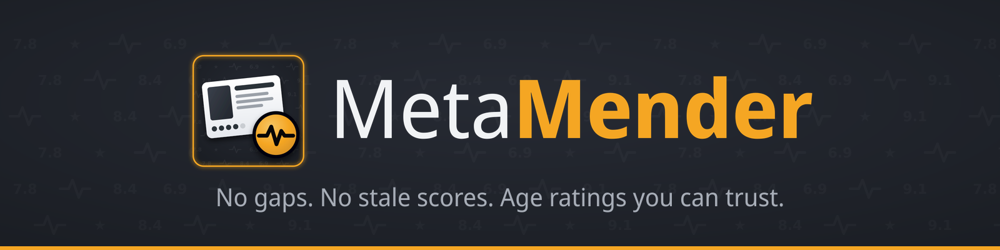
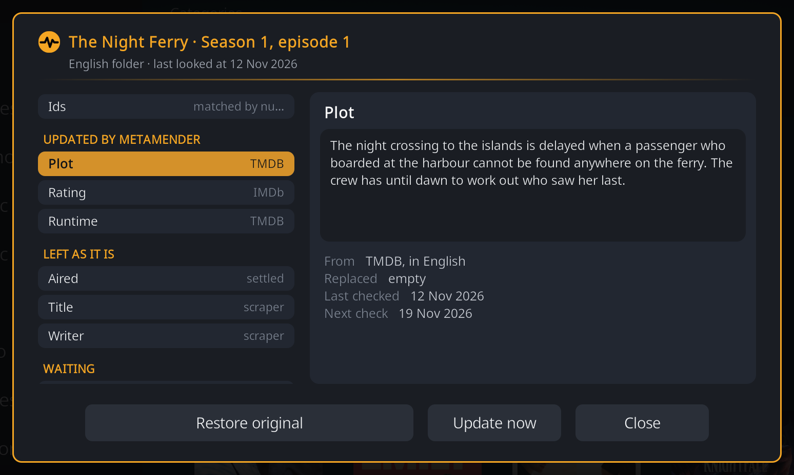

# MetaMender

MetaMender is a Kodi add-on that quietly improves your video library in the
background. It fills in what your scraper left empty, keeps scores up to date
while they still change, and gives your movies and shows an age rating from
your own country.

## What it fixes

**Gaps get filled.**
:   Missing plots, episode titles, credits, taglines and more are filled in
    from TMDB and TheTVDB, in each folder's own language, with an optional
    fallback language for what does not exist in yours.
    [What to fill](setup.md#4-what-to-fill)

**Scores that keep up.**
:   Scrapers fetch an episode's score once, often in its first week when it has
    a handful of votes, and it stays like that. MetaMender checks new movies
    and episodes again while the votes come in, then leaves them alone once
    they settle. [How often a field is checked](scans.md#how-often-a-field-is-checked)

**Age ratings you can trust.**
:   Age ratings in your own country's system, for ten countries, from TMDB,
    official rating sites, or converted from neighbouring countries. Useful
    when you decide what the kids may watch. [Age ratings](age-ratings.md)

## Highlights

- **Respects what is yours.** Items with an NFO file keep their values, and
  a value MetaMender replaced can be put back from the Details window.
  [The Details window](details.md)
- **Shows its work.** For any movie, show or episode, the Details window says
  where each value came from and why a field was left alone.
  [The Details window](details.md)
- **Careful with episodes.** Episodes from scrapers that store no ids, such as
  TVmaze, are matched by number only when the date or title agrees.
  [How items are matched](where-data-comes-from.md#how-metamender-knows-which-item-it-is)
- **Quiet.** Nothing on screen while you watch; a short notification after a
  scan that changed something; a window only when something needs you.
  [Scans](scans.md)
- **Update now.** Refresh a movie, show, season or episode from its context
  menu. [Update now](update-now.md)

## Where to start

New here? [Install](install.md) MetaMender, then walk through the
[setup](setup.md). Coming from EU Certification Fixer? Read
[this first](coming-from-eu-cert-fixer.md).

## All pages

| Page | What it covers |
|---|---|
| [Install](install.md) | What you need, the Rouzax repository, a zip file |
| [Setup](setup.md) | The TMDB key, languages, what to fill, the age rating country |
| [Scans](scans.md) | When MetaMender scans, how often a field is checked, what you see |
| [Update now](update-now.md) | Refreshing one item, show or season right away |
| [The Details window](details.md) | Why a field looks the way it does; Restore original and the lock |
| [Age ratings](age-ratings.md) | Countries, where ratings come from, what is kept |
| [Coming from EU Certification Fixer](coming-from-eu-cert-fixer.md) | Switching over |
| [Settings](settings.md) | Every setting explained |
| [Where your data comes from](where-data-comes-from.md) | What MetaMender reads and writes, field by field |
| [Troubleshooting and FAQ](troubleshooting.md) | Common questions and problems |
