# Libraries

MetaMender only works in the libraries you include, and each library has its
own settings: its language, what MetaMender fills there, which rating Kodi
shows, and the country for age ratings. So a kids' library can keep its
original titles while your main movie library gets English ones, and a
library of sport recordings can be left alone entirely.

You choose all of this in the library list. It is the second step of
[setup](setup.md), and after setup you open it with **Libraries** in the
MetaMender settings (**Add-ons > My add-ons > Program add-ons > MetaMender >
Configure**, **Backfill** tab).

## What a library is

A library is one of Kodi's video sources: a folder you added to Kodi's video
library, with the name you gave it there. A source with several folders
(a multipath source) is one library.

MetaMender recognises a library by its folder, not its name: renaming a
source in Kodi keeps its settings. A source whose folder path changed appears
as a new library, not included, next to the old entry, unless its new folder
lies inside the folder of a library already in the list: it is then not
listed separately, and its items stay part of that library, with that
library's settings.

A library removed from Kodi stays in MetaMender's list under its last known
name, and MetaMender still looks after it while its items remain in Kodi's
library. Leave it out to stop that.

On a device that shares another device's library database, Kodi often has no
video sources of its own. MetaMender then lists the top folders it finds in
the library instead, and treats each as a library.

## The library list

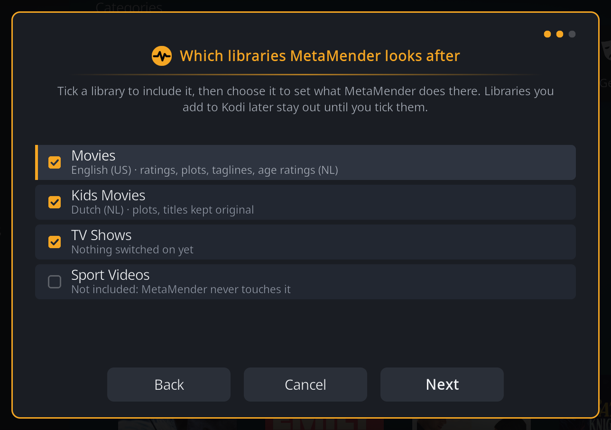

Every library Kodi has is listed. The line under each name sums up what
MetaMender does there: its language and the fields it fills, **Nothing
switched on yet** for an included library with every field off, or **Not
included** for a library MetaMender never touches.

Choose a library to change it:

- **Include** (a library that is left out) includes it and opens its page.
- **Change settings** (an included library) opens its page.
- **Leave out** stops MetaMender working there. See
  [Leaving a library out](#leaving-a-library-out).

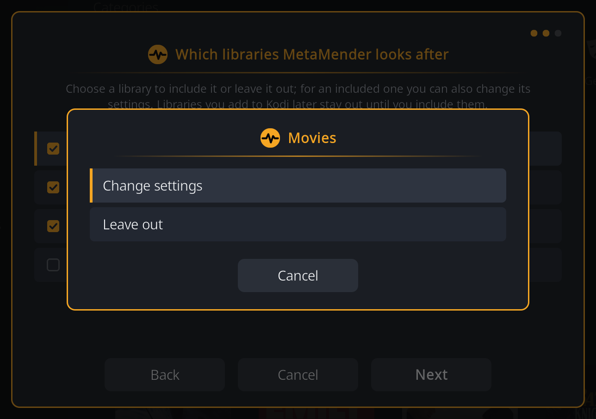

Including a library changes nothing by itself: a library you include for the
first time has every field switched off, so MetaMender does not write to it
until you tick something on its page. Its settings are saved when you choose **Finish** in
setup, or **Save** when you opened the list from the settings.

If you changed something and then choose **Cancel**, or Back on the list,
MetaMender asks whether to save your changes. **Yes** saves them as **Save**
(or, in setup, **Finish**) does; **No** leaves every library as it was. Back
on a library's page only returns to the list.

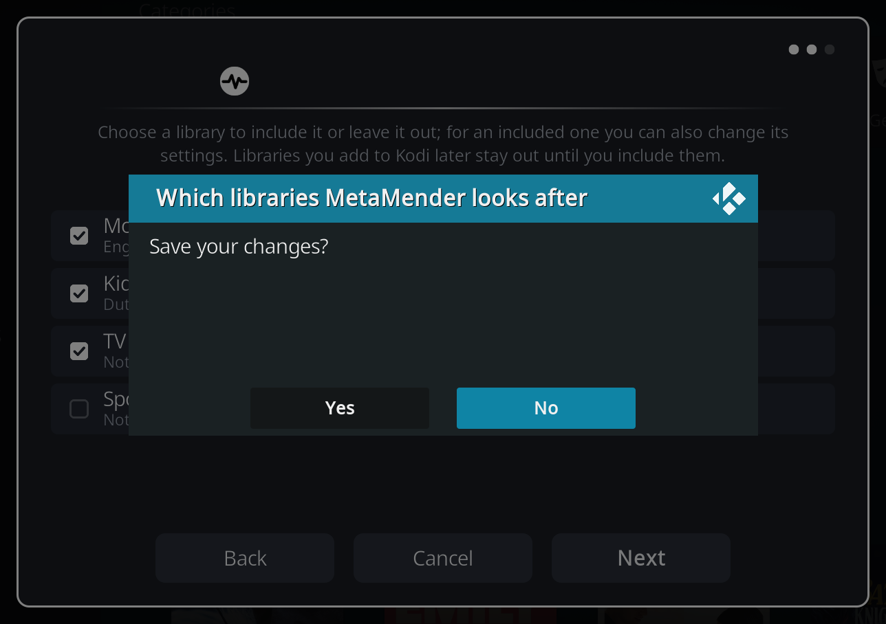

## A library's page

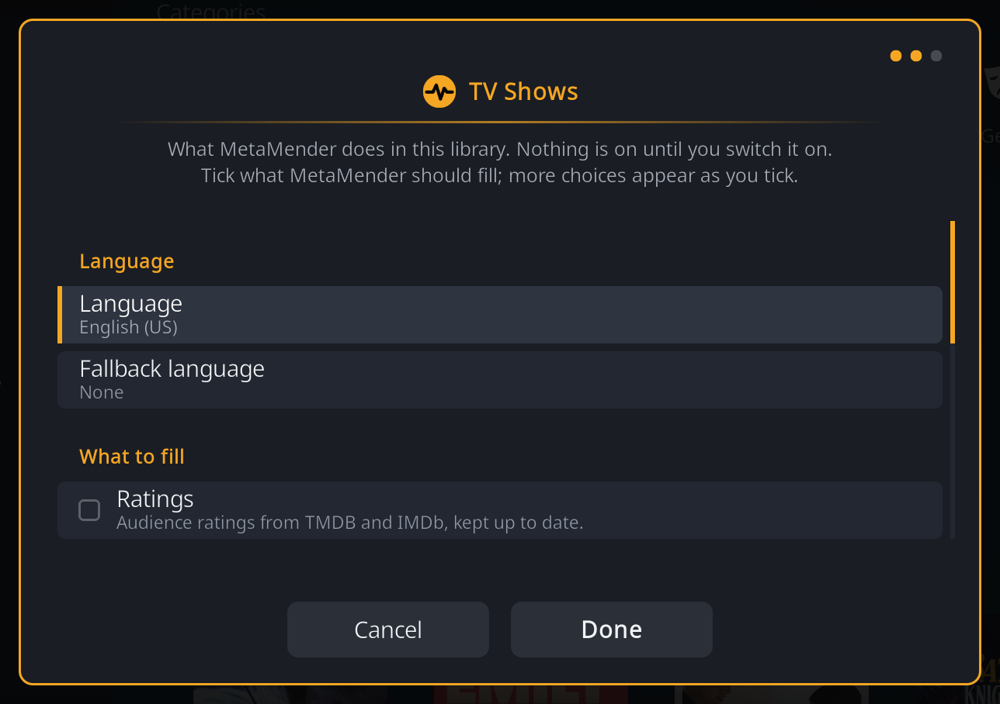

The page holds every choice for one library, in groups. The first two groups,
**Language** and **What to fill**, are always there; the others appear only
while a field they are about is ticked, so a library that only fills plots
has a short page. **Done** (or Back) returns to the list.

### Language

**Language**
:   The language MetaMender writes plots, titles, taglines and genres in for
    this library. A new library starts with Kodi's interface language.

    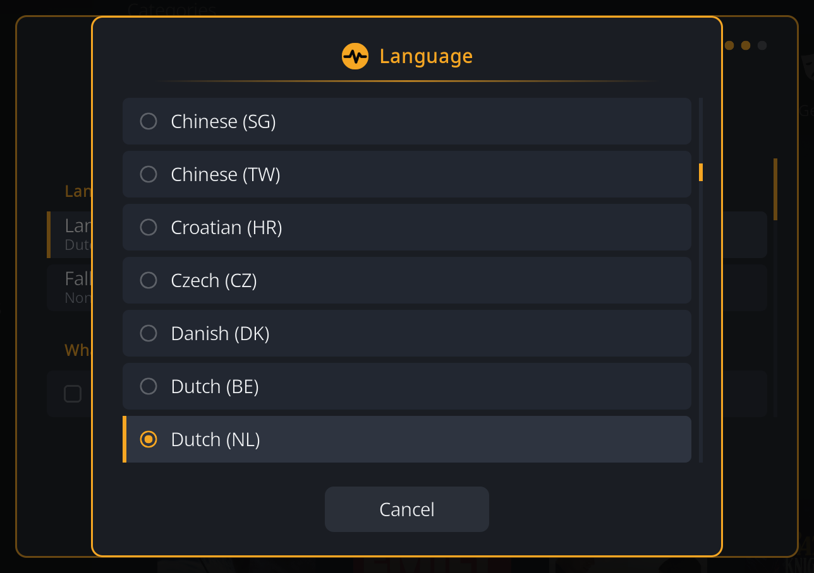

**Fallback language**
:   Optional. When a plot or episode title does not exist in the library's
    language, MetaMender uses the fallback language instead, but only to fill
    an empty field; it never replaces text that is already there with text in
    the fallback language. Leave it on **None** if you would rather keep a
    field empty than have it in another language. Show and movie titles never
    come from the fallback language.

!!! example
    A Dutch library with English as its fallback gets Dutch plots wherever
    TMDB or TheTVDB has one, and an English plot only where there is no Dutch
    one and the field would otherwise stay empty.

### What to fill

Tick what MetaMender may fill in and keep up to date in this library. Nothing
is ticked in a newly included library. A value that comes from an NFO file is
never changed, whatever you tick here.

| Choice | What it covers |
|---|---|
| Ratings | Audience ratings from TMDB and IMDb, kept up to date |
| Plots | Movie, show and episode plots in the library's language |
| Episode titles | Episode titles in the library's language |
| Show and movie titles | Replaces a show's or movie's title, see [Titles](#titles) |
| Age certifications | Fills and corrects age ratings in one country's system |
| Credits | Directors and writers |
| Trailers | Trailer links from TMDB |
| Taglines | Movie taglines in the library's language |
| Posters | Fills empty posters of movies, shows and seasons, and refreshes posters from TMDB or fanart.tv while a title is new; see [Posters and episode thumbs](#posters-and-episode-thumbs) |
| Episode thumbs | Replaces an episode thumb Kodi grabbed from the video, and a broken or empty one, with the official episode still |
| Details | Genre, studio, country, runtime and first aired date |

Unticking a field stops MetaMender changing it from then on; the values it
already wrote stay.

### Rating

Shown while **Ratings** is ticked. Kodi shows one audience rating per movie,
show or episode; **Which rating to show** decides which one. MetaMender keeps
the ratings up to date while new votes come in.

| Choice | Kodi shows | Kept up to date |
|---|---|---|
| Follow your scraper (the default) | The rating your scraper chose | TMDB and IMDb |
| Prefer TMDB | TMDB's, or IMDb's when TMDB has none | TMDB and IMDb |
| Prefer IMDb | IMDb's, or TMDB's when IMDb has none | TMDB and IMDb |
| TMDB only | TMDB's | TMDB only |
| IMDb only | IMDb's | IMDb only |

**Follow your scraper** is right for most libraries. An item with an NFO file
keeps the rating its NFO file chose, whatever you pick.

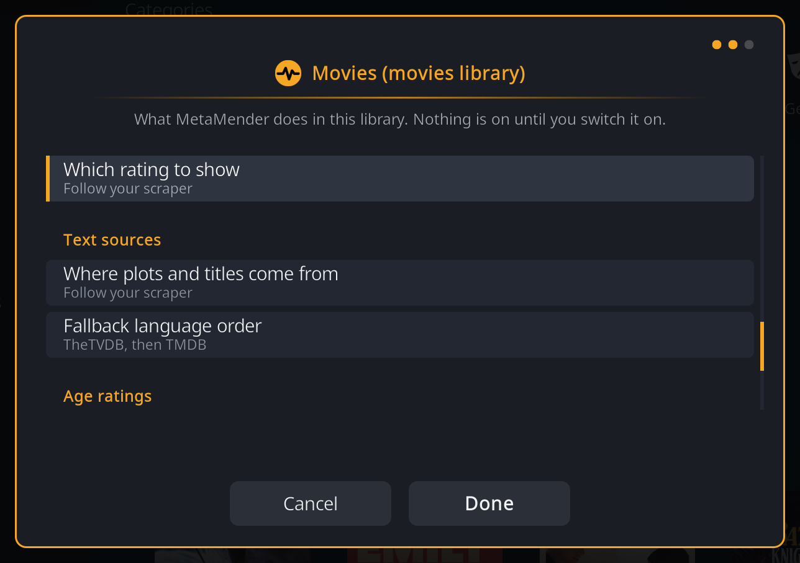

### Text sources

Shown while **Plots**, **Episode titles** or **Show and movie titles** is
ticked. Both choices only matter for TV shows and episodes: movies always get
their plots and titles from TMDB, so in a library of movies you can leave
them as they are.

**Where plots and titles come from**
:   For shows and episodes MetaMender asks TMDB and TheTVDB, one after the
    other, until one has the text in the library's language.
    **Follow your scraper** (the default) asks the site your scraper used
    first, so the wording matches the rest of the show; when MetaMender
    cannot tell which scraper added a show, it asks TMDB first. **TMDB, then
    TheTVDB** and **TheTVDB, then TMDB** use that order for every show.

**Fallback language order**
:   The order in which the two sites are asked in the fallback language,
    when neither has the text in the library's language. The default is
    **TheTVDB, then TMDB**.

### Titles

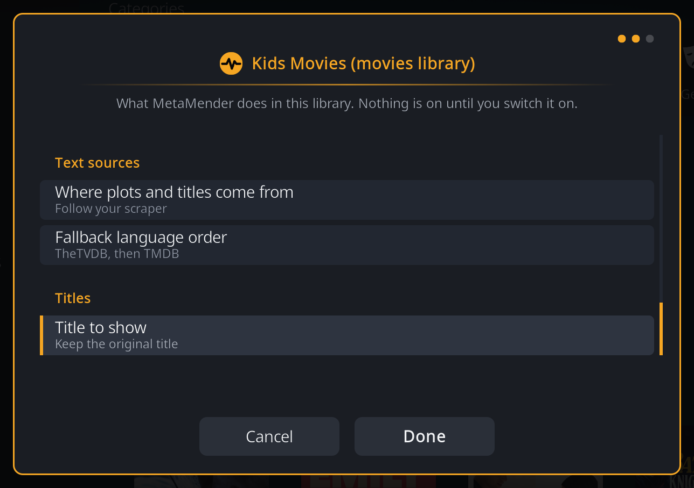

Shown while **Show and movie titles** is ticked. **Title to show** decides
which title movies and shows in this library get:

**In the library's language** (the default)
:   The title TMDB (or, for shows, TheTVDB) has in the library's language.
    MetaMender only uses a title the site really has in that language; when
    there is none, the title stays as it is.

**Keep the original title**
:   Every movie and show in this library gets its original title, in its own
    language and script, whatever the library's language is.

Keep the original title is for a library where translated titles get in the
way, such as children's films and series you know by their own name. In an
English library the Dutch children's film *Dikkie Dik* stays *Dikkie Dik*
instead of becoming *Tummy Tom*. It applies to every movie and show in the
library, so an English film keeps its English title and a Japanese film gets
its Japanese title, in Japanese script. To keep original titles for only some
of your films, put those in a library of their own.

What keep the original title does not change:

- **Episode titles** and every other text, such as plots, still follow the
  library's language.
- **A title from an NFO file** is kept, as for every field.
- **A movie or show without a TMDB id** keeps its title. Shows scraped with
  TheTVDB usually get their TMDB id through their other ids, and then work
  too.

The original title is TMDB's (its "original title" for movies and "original
name" for shows), the same one the TMDB scrapers' own **Keep original title**
setting uses.

### Posters

Shown while **Posters** is ticked.

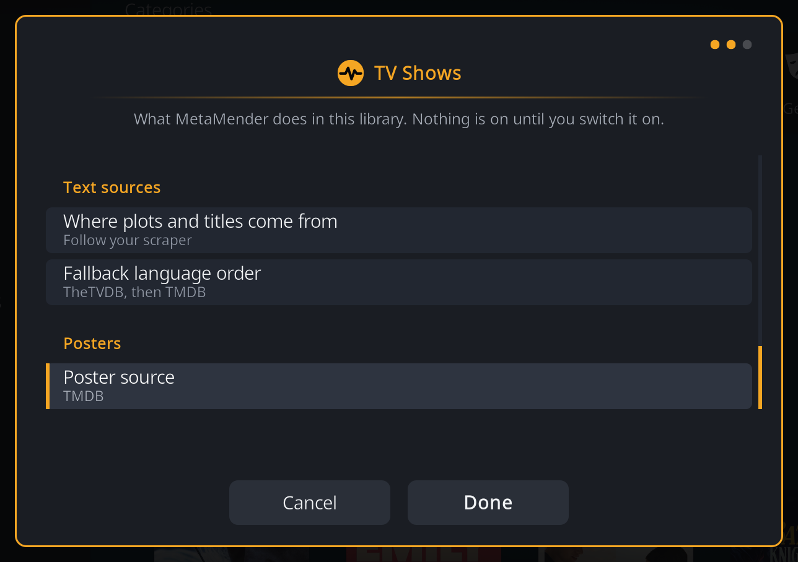

**Poster source**
:   The site MetaMender takes movie, show and season posters from first:
    **TMDB** (the default) or **fanart.tv**. Choose fanart.tv if you prefer
    its posters; with either choice, a poster in the library's language
    comes first, whichever site has it.

MetaMender takes the first of these that exists:

1. A poster in the library's language from the poster source, then one from
   the other site.
2. The same in the fallback language, if the library has one.
3. A poster without text, poster source first.

Within one site the best rated poster wins: on TMDB by its votes, weighted so
that a poster with only a few votes counts for less than one with many, and on
fanart.tv by its likes. If neither site has a poster, the current one stays.

!!! example
    A Dutch library with English as its fallback and TMDB as its poster source.
    A movie has no Dutch poster on TMDB, but fanart.tv has one: MetaMender
    picks the Dutch poster from fanart.tv over every English poster on TMDB.

Two rules keep a good poster in place:

- **A current poster stays** unless a better one clearly leads, so posters
  do not swap back and forth between two that are about as good.
- **A poster nobody rated yet** (no votes on TMDB, no likes on fanart.tv)
  never replaces one in the same language that has votes or likes. It can
  still fill an empty poster.

Language comes before votes: a poster in the library's language replaces one
in the fallback language, another language or without text even when nobody
rated it yet, and a poster in the fallback language replaces one without
text. A poster in the fallback language or without text is checked again
every month for about a year, so a poster in the library's language replaces
it once one appears.

fanart.tv finds a movie by its TMDB or IMDb id and a show by its TheTVDB id.
A show without a TheTVDB id only gets posters from TMDB.

### Age ratings

Shown while **Age certifications** is ticked. See [Age ratings](age-ratings.md)
for the countries, where ratings come from and what MetaMender writes.

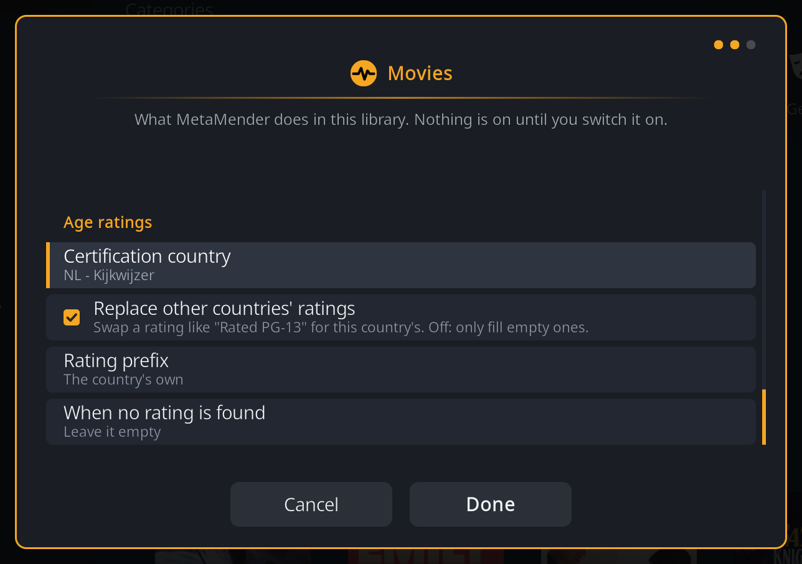

**Certification country**
:   The country whose rating system the library's age ratings are written in.
    **Automatic** (the default) uses the country of the library's language,
    so a library in Dutch (NL) gets Kijkwijzer for the Netherlands. Only a
    language without a country, such as plain English, makes Automatic use
    the country of Kodi's interface language instead. When that country has
    no rating system in MetaMender, as for a library in Spanish (ES),
    Automatic says so, and the page does not close until you choose a
    country.

**Replace other countries' ratings**
:   Ticked (the default), a rating from another country's system, such as
    "Rated PG-13" in a Dutch library, is replaced with this country's rating.
    Unticked, MetaMender only fills items that have no rating. Ratings already
    in this country's system are kept either way, and ratings from an NFO file
    are never replaced.

**Rating prefix**
:   What is written before the rating. **The country's own** (the default)
    writes the usual prefix, such as `NL:` in `NL:12`. **No prefix** writes
    the rating alone (`12`), and **Custom prefix** writes a prefix you type.
    Change it only if your skin expects something else.

**When no rating is found**
:   **Leave it empty** (the default) keeps an item without a rating empty.
    **Write a value** lets you type a value (`NR` is suggested) that
    MetaMender writes into ratings that are still empty after a year of
    monthly checks, so you can see that the item was checked.

## Posters and episode thumbs

**Posters** and **Episode thumbs** are off until you tick them, also in a
library you set up before MetaMender handled art. MetaMender changes only
which image Kodi points at: it does not download images or save image files.

### What MetaMender changes

| Art | Changed when it is |
|---|---|
| Episode thumb | Empty, a frame grab Kodi took from the video, or a broken link. It gets TMDB's episode still, or TheTVDB's episode image when TMDB has none. |
| Movie, show or season poster | Empty or a broken link: filled. A poster from TMDB or fanart.tv: replaced when a better one leads (see [Posters](#posters)), while the title is new. |

A frame grab is the picture Kodi takes from the video file when an episode
has no thumb; on HDR and Dolby Vision files it looks washed out. A broken
link points at a site but at no image, so Kodi shows nothing.

Posters and thumbs are checked on the same schedule as other fields: once
when MetaMender first sees an item, then again while the title is new, then
never again (see [how often a field is checked](scans.md#how-often-a-field-is-checked)).
A title that is already old gets one check. For a season, its age is that of its first episode.

### What MetaMender leaves alone

- **Local image files**, such as the posters and thumbs the Artwork Dump
  add-on saved next to your videos. MetaMender cannot tell one you picked
  from the rest, so it changes none of them.
- **An episode thumb that is already an image on a website**, such as a TMDB
  still your scraper chose.
- **A poster from any other website** than TMDB or fanart.tv.
- **A poster that changed outside MetaMender.** MetaMender remembers the
  poster an item had when it first looked at it with **Posters** ticked. If
  the poster is later something other than that one or the one MetaMender
  wrote, you (or another add-on, or a refresh in Kodi that brings a different
  poster) chose it, and MetaMender locks it for good.
  The [Details window](details.md#posters-and-episode-thumbs) says so, and
  **Let MetaMender update this again** unlocks it: MetaMender then treats
  the poster it finds as the one it first saw.
- **Art from an NFO file.** On an item with an NFO file, MetaMender only fills
  a poster or thumb that is empty, a frame grab or a broken link. A season
  follows its show's NFO file.
- **A field you locked** in the Details window.
- **In a folder without a language** (only possible by editing MetaMender's
  `sources.json` file), posters are only filled when empty or broken.

One case MetaMender cannot recognise: a poster you picked in Kodi before
you ticked **Posters** for the library. If it comes from TMDB or fanart.tv,
it looks like your scraper's choice and may be replaced once, at the first
scan after ticking. Ticking **Posters** accepts that. To get such a poster
back, open the item's Details window and choose **Restore original**: it
puts the poster back and locks it. To protect one before it is replaced,
choose **Keep this value** on it once **Posters** is ticked, before the next
scan.

A season is left alone while MetaMender does not know its show's TMDB id.

### If you use Artwork Dump

MetaMender writes no image files. The art it sets is a link to the image on
TMDB, TheTVDB or fanart.tv, which Kodi downloads and caches. If you run
Artwork Dump again, it saves the new art as files next to your videos; from
then on they are local files, which MetaMender leaves alone.

## When your changes apply

A change you save applies from the next scan; nothing is scanned when you
save, except when you choose **Finish** in the first setup, which starts the
first scan straight away. At that scan MetaMender checks the fields your change affects again in
that library's items, even fields it had already settled, so a new language
or a new title choice reaches every item. Other libraries are not affected.
To see the result on one item straight away, use [Update now](update-now.md).

## Leaving a library out

Choose **Leave out** for a library MetaMender should not touch any more. From
the next scan on, it skips every item in that library.

- **What MetaMender already wrote stays.** Leaving a library out does not undo
  anything.
- **Its history stays.** MetaMender keeps its records of the library's items,
  so the [Details window](details.md) still shows where a value came from and
  **Restore original** still puts back what a field held before.
- **Its settings are kept.** Include the library again and its page has the
  choices it had, and MetaMender continues where it stopped.

**Update now** on an item in a library that is left out changes nothing; a
notification says the library is not included in MetaMender and that you can
include it under **Libraries**.

## Libraries added to Kodi later

A video source you add to Kodi after setup stays out: MetaMender never starts
working in a library on its own. The first scan that finds it adds it to the
list as not included and shows one notice.

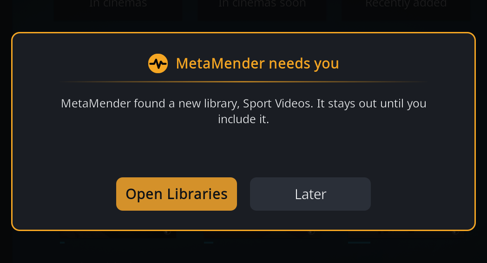

**Open Libraries** opens the list, where you include it and choose its
settings. **Later** closes the notice; the library stays out until you
include it, and the notice does not come back for it.

## Items in no library

An item whose file lies under none of the libraries in the list, for example
because its path is spelled differently from its source's, has no library
settings, so MetaMender skips it, and **Update now** on it changes
nothing. When a scan finds such items, a
notice says how many there are ("12 items are in no MetaMender library"). It
comes back only when the number grows. To have MetaMender update them, add
their folder to Kodi as a video source and include it in the list.

## Upgrading from 1.1

MetaMender 1.1 had one set of choices for every library, plus a language per
folder. The first time MetaMender 1.2 starts, it converts these once:

- **Every library MetaMender scanned before is included** and gets exactly
  the choices it had: the fields to fill, the rating to show, where plots and
  titles come from, the age rating options, and its folder's language and
  fallback language. A certification country that was **Automatic** is now
  the country it chose, so it cannot change.
- **A source you had switched off by editing MetaMender's `sources.json`
  file** becomes a library that is left out. It gets the same choices anyway,
  so including it later starts from what you had. A folder inside a library
  that you switched off that way stays switched off.
- **A setting for a folder above a library**, such as a language for the
  whole share that holds your Movies and Series sources, gives each library
  inside it that language, or leaves it out if that folder was switched off,
  as it did in 1.1.
- **Title to show** is **In the library's language**, which is what 1.1 did.

Nothing in your library changes and nothing is fetched again because of the
conversion. One notice says that the settings are now per library;
**Open Libraries** shows the result.

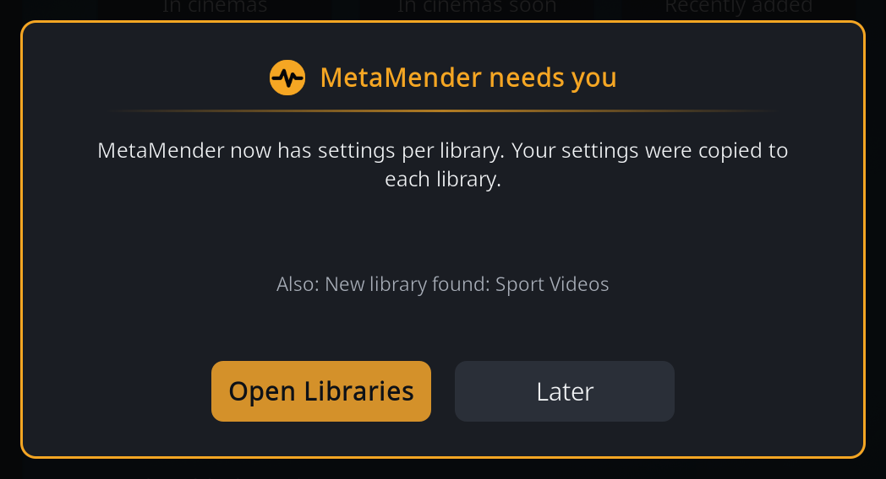

Kodi removes settings an add-on no longer has from its settings file, for
example when you open MetaMender's settings, so MetaMender copies your 1.1
choices aside as soon as it starts. If Kodi removed them before that copy
was made, MetaMender cannot know what you had chosen and does not guess:
every library 1.1 scanned is still included with its language, but nothing
is switched on, and the notice says that your earlier choices could not be
read. Open **Libraries** and tick what each library should fill.

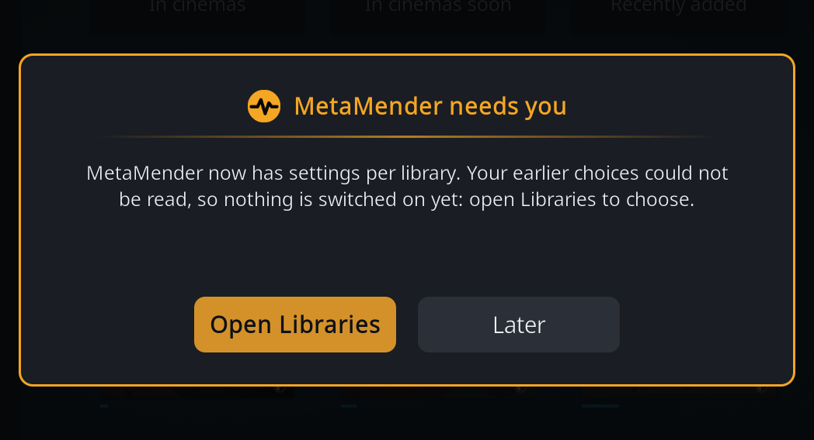

The conversion needs to know your libraries. If MetaMender finds none when it
starts (Kodi lists no video sources and the library has no items, or Kodi
does not answer), it tries again a few minutes later. Until the conversion
has run, MetaMender does not scan, and **Libraries** in the settings says
that your settings have not been moved yet.
