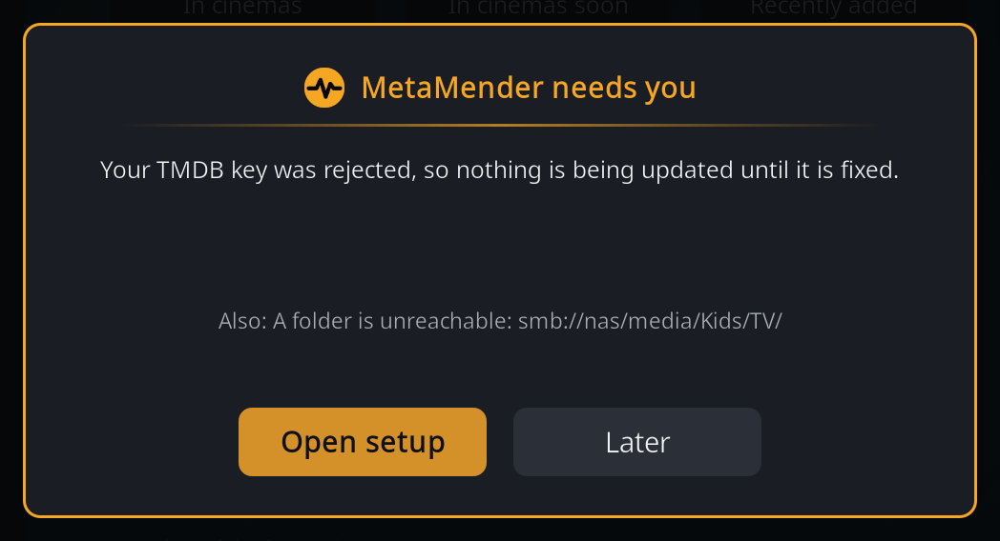

# Scans

After setup MetaMender works on its own, in the background. This page explains
when it looks at your library, how often it checks a field again, and what
you see while it works.

## When MetaMender scans

- **Every day.** A background scan runs once every 24 hours (change this with
  **Scan interval** in the [settings](settings.md)). The first one
  starts when Kodi starts.
- **After a library update.** When Kodi finishes updating or cleaning the
  video library, MetaMender waits five minutes and then looks at the items
  that are new to it. A scheduled scan that is due at the same time covers
  them anyway.
- **When you ask.** [Update now](update-now.md) refreshes one movie, show,
  season or episode right away.

A scan does not start while a video plays, and a scan that is running pauses
when you start a video and carries on when you stop. If Kodi closes in the
middle of a scan, the next one continues where it left off (switch this off
with **Resume interrupted scans**).

## How often a field is checked

MetaMender does not fetch everything every day. It remembers, per item and per
field, when it last checked and when the next check is due:

- **The first check** happens at the first scan that sees the item.
- **New movies and episodes** change most: a score has few votes at first, and
  plots and episode titles are often added after release. MetaMender checks
  them again after about a week, then about a month later, then about three
  months later, and once more when the item is a year old.
- **After that the field is settled** and MetaMender leaves it alone. Content
  that is already more than a year old is settled after its first check.

So a score that was 9.4 from 12 votes in an episode's first week gets
refreshed while the votes come in, instead of staying 9.4 forever.

Some exceptions:

- **Age ratings** from a real source (TMDB or the official site for your
  country) are settled after one answer: they do not change. An age rating
  MetaMender had to work out from another country's rating is checked again
  every month for about a year, in case the real one appears.
- **A text from the fallback language** is checked again every month for about
  a year, so a version in your own language replaces it when one appears.
- **A field MetaMender could not check** (a site did not answer) is tried
  again at the next scan; a failed check never counts as a check.

The exact schedule is in the settings: **Staleness threshold** (the one year)
and **Refresh schedule** (the week, month and three months; shown at the
Advanced settings level). The [Details window](details.md)
shows, per field, when it was last checked and when it is due next.

## What you see

Nothing, most of the time. MetaMender is quiet on purpose:

- **While anything plays**, video or music, MetaMender shows nothing at all.
- **After a background scan that changed something**, a small notification
  says how many items were updated. A scan that changed nothing shows nothing.
  Switch these off with **Show notifications**.
- **When something needs you**, a window says so, whatever the notification
  setting.

The **MetaMender needs you** window appears, when nothing plays, for these
problems:

| The window says | What to do |
|---|---|
| Setup has not been finished yet | Choose **Open setup** and finish it. Nothing is updated before that. |
| There is no TMDB key | Choose **Open setup** and enter your key. |
| Your TMDB key was rejected | Choose **Open setup** and enter the key again; check that it is the API Key, not the Read Access Token. |
| The last background scans did not finish | Background scans failed at least three times over at least a day. The log has the details (see [Troubleshooting](troubleshooting.md)). |
| A folder is unreachable | A library folder has been unreachable for three days or more, for example a network share that is off. Its items are not updated until it is back. |

When there is more than one problem, the most important one is shown and the
others are listed under **Also**. **Later** closes the window; it does not come
back for the same problem, but does for a new one.

If TheTVDB stops accepting MetaMender's own key, a notification says so once.
Titles and plots from TheTVDB are paused until it works again; TMDB carries on.
