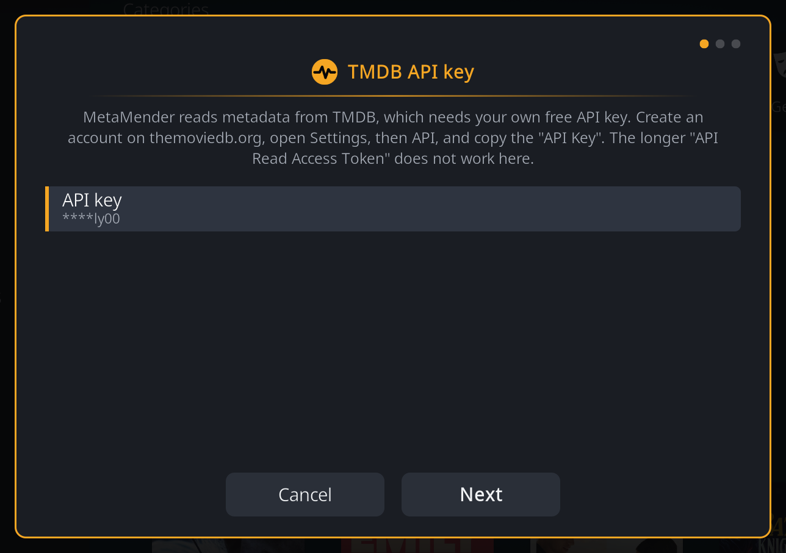
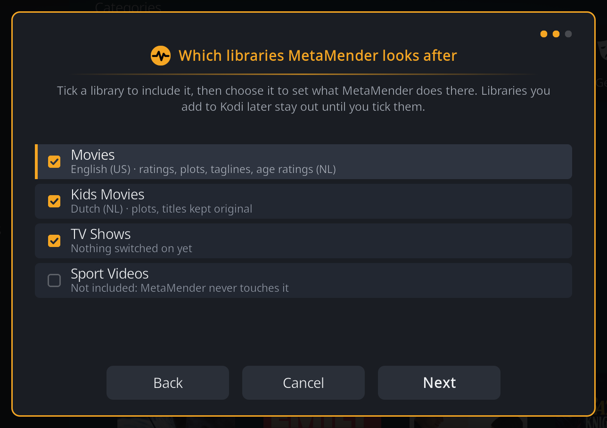
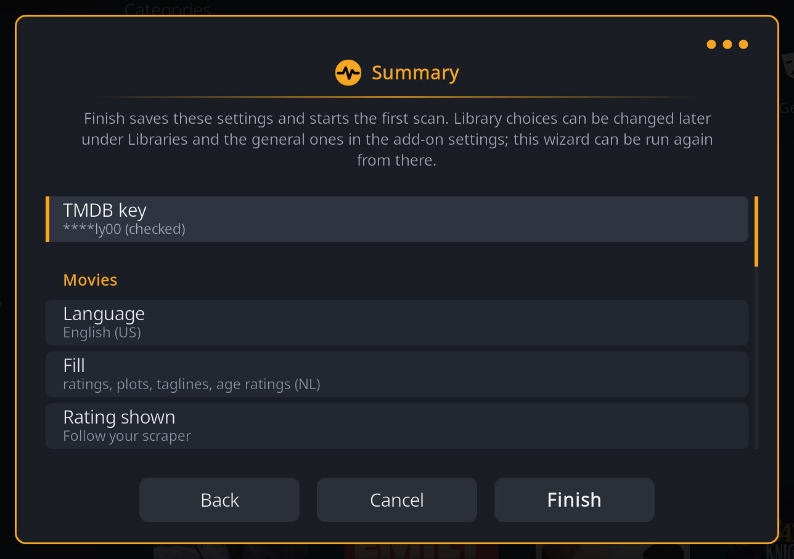

# Setup

Setup has three steps: your TMDB key, the libraries MetaMender looks after
(with each library's own choices), and a summary. Everything else has sensible
defaults that you can change later in the [settings](settings.md).

Setup opens when you choose **Open setup** in the "MetaMender needs you"
window, or when you open MetaMender from **Add-ons > Program add-ons**.
Nothing is scanned or changed until you choose **Finish** on the last step;
**Cancel** on any step leaves everything as it was.

Use the remote as usual: up and down to move, OK to choose, and Back for the
previous step. The dots in the top corner show how far along you are.

## 1. TMDB API key

MetaMender reads most of its information from TMDB, which needs your own free
key:

1. Create a free account at [themoviedb.org](https://www.themoviedb.org/signup).
2. On the website, open your account **Settings**, then **API**, and request
   a key for personal use.
3. Copy the value called **API Key** (a short string of letters and digits).
   The much longer **API Read Access Token** does not work here.
4. In setup, choose **API key**, type or paste the key, and choose **Next**.

MetaMender checks the key with TMDB when you choose **Next**:

- **Refused:** a message says TMDB refused the key. Check that you copied the
  API Key and not the Read Access Token, then enter it again.
- **TMDB could not be reached:** the key is saved as you typed it, unchecked.
  If it turns out to be wrong, MetaMender tells you after its first scan.

After setup the key is only ever shown masked, like `****ab12`.

## 2. Libraries

This step lists your libraries: the video sources you added to Kodi. Choose
a library and then **Include**; its page opens, where you choose what
MetaMender does there: the language, what to fill, which rating to show,
where plots and titles come from, and the age rating country. **Done**
returns to the list, where you can include the next one. A library you leave
unticked is never touched.

On each library's page, tick what MetaMender may fill. **Ratings**, **Plots**
and **Age certifications** are a good start for most libraries.

Nothing is switched on in a library you include until you tick it on its
page, so including a library and choosing **Next** changes nothing. If you
include no library or tick nothing, the summary says that MetaMender will not
change anything.

[Libraries](libraries.md) explains every choice on a library's page,
including [Keep the original title](libraries.md#titles).

!!! note "No libraries listed?"
    If Kodi has no video sources (for example on a device that shares another
    device's library database), MetaMender lists the folders it finds in the
    library instead. If it finds none either, add your folders to the library
    first; you can set them up later with **Libraries** in the settings.

## 3. Summary

The summary shows your TMDB key, then each included library with its choices,
then the libraries left out. Choose **Back** to change something, or
**Finish**.

**Finish** saves the settings and starts the first scan straight away. The
first scan goes through your whole library, so on a large library it takes a
while; Kodi stays usable meanwhile. When it is done, a notification says how
many items were updated. After that MetaMender scans by itself, once a day by
default (see [Scans](scans.md)).

## Changing your answers later

Open the MetaMender settings (**Add-ons > My add-ons > Program add-ons >
MetaMender > Configure**). On the **Backfill** tab, under **Sources**:

- **Libraries** opens the library list on its own, to include or leave out a
  library or change its choices. **Save** keeps your changes. See
  [Libraries](libraries.md).
- **Run setup wizard** walks through all three steps again, starting from
  your current answers.

Either way, changes apply from the next scan; no scan starts by itself. The
settings also hold everything that is not chosen per library, such as how
often MetaMender scans. See [Settings](settings.md).
