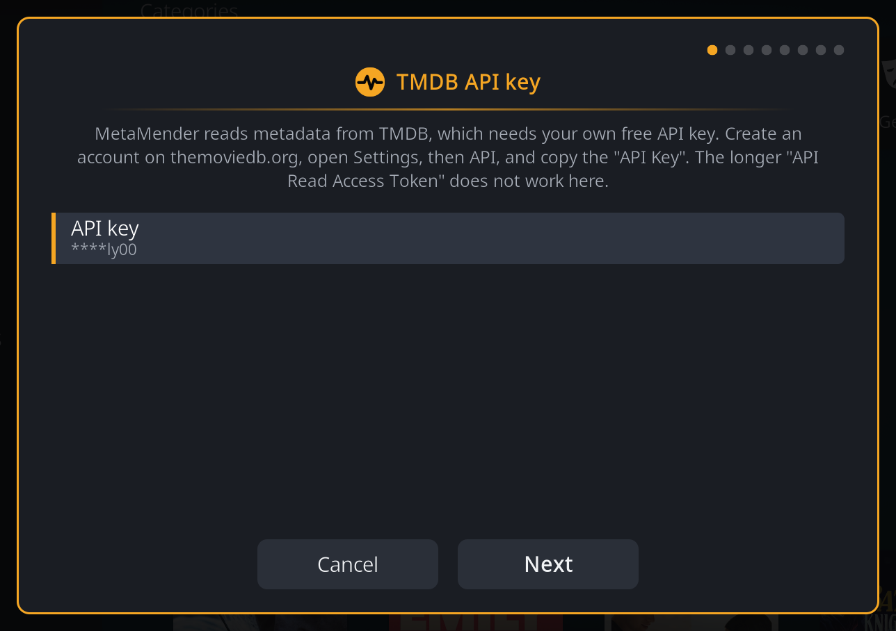
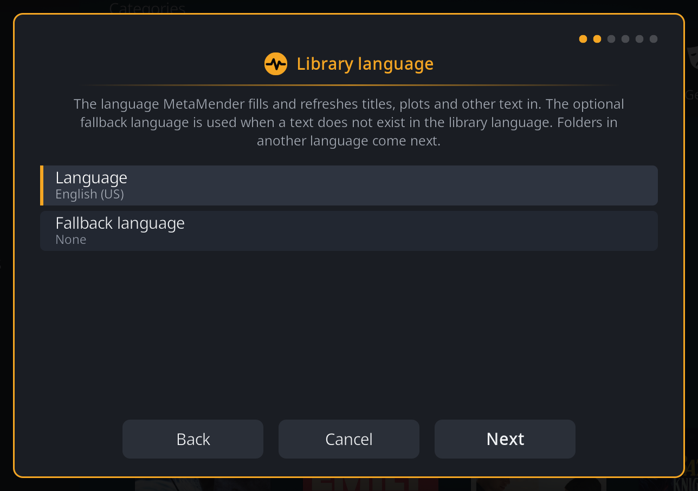
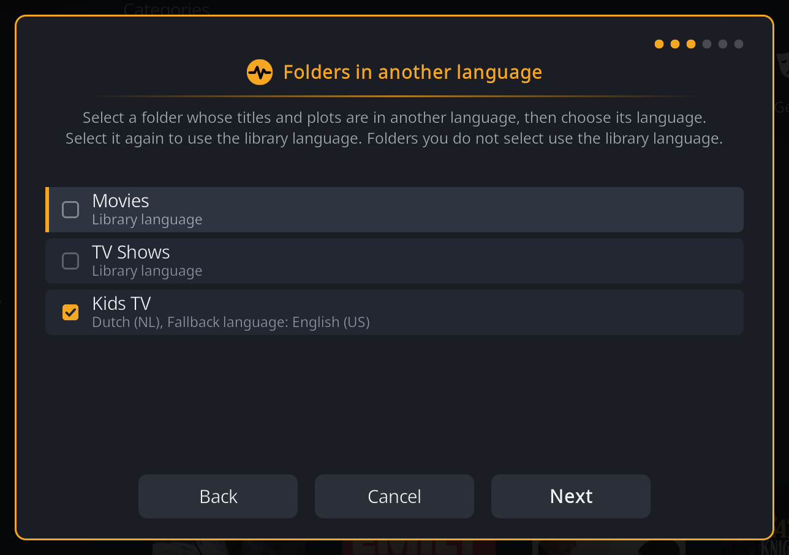
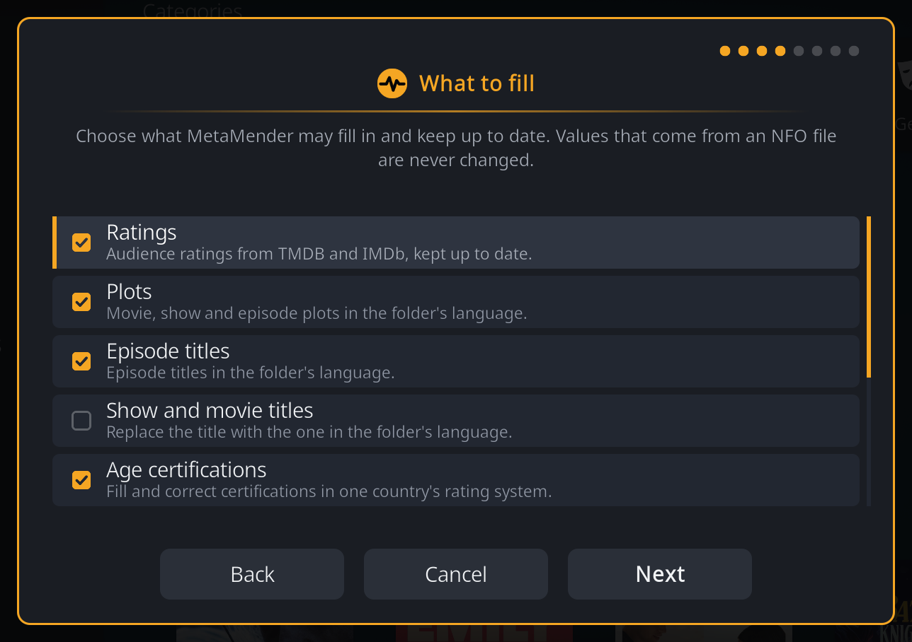
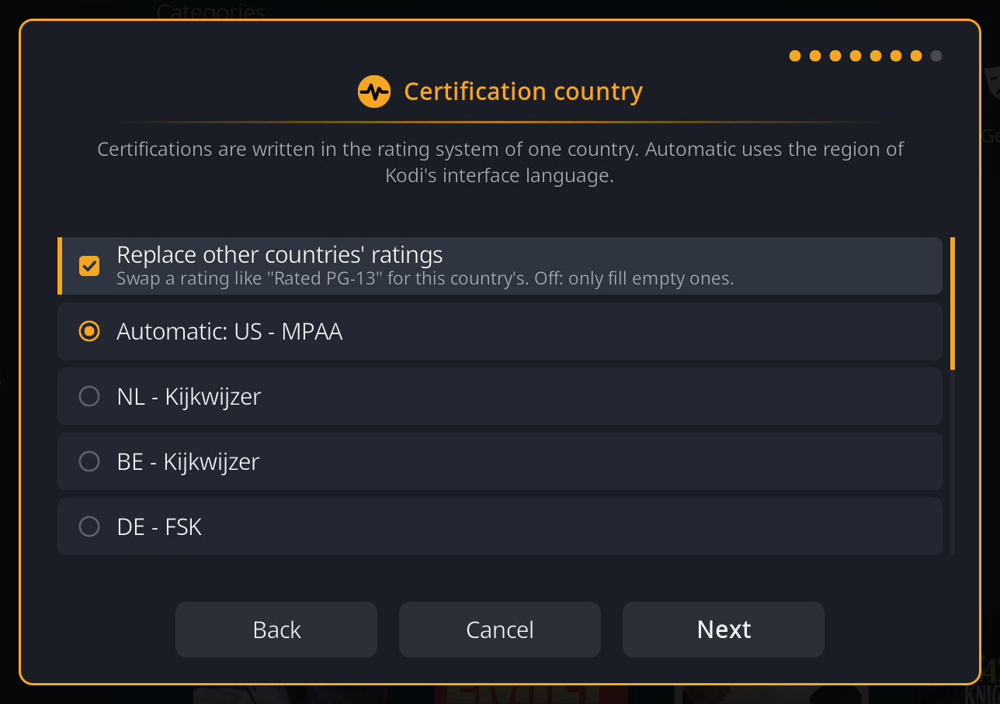
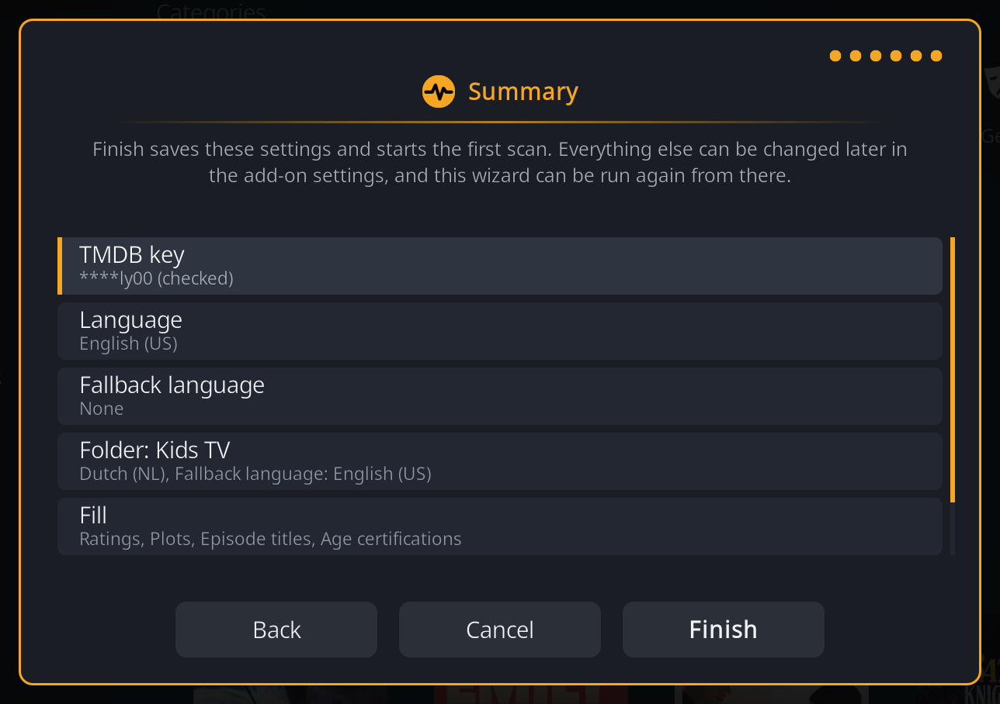

# Setup

MetaMender asks a few questions before it touches your library: your TMDB
key, the languages your library is in, and what it may fill in. Everything
else has sensible defaults that you can change later in the
[settings](settings.md).

Setup opens when you choose **Open setup** in the "MetaMender needs you"
window, or when you open MetaMender from **Add-ons > Program add-ons**.
Nothing is scanned or changed until you choose **Finish** on the last step;
**Cancel** on any step leaves everything as it was.

Use the remote as usual: up and down to move, OK to choose, and Back for the
previous step. The dots in the top corner show how far along you are.

## 1. TMDB API key

MetaMender reads most of its information from TMDB, which needs your own free
key:

1. Create a free account at [themoviedb.org](https://www.themoviedb.org/signup).
2. On the website, open your account **Settings**, then **API**, and request
   a key for personal use.
3. Copy the value called **API Key** (a short string of letters and digits).
   The much longer **API Read Access Token** does not work here.
4. In setup, choose **API key**, type or paste the key, and choose **Next**.

MetaMender checks the key with TMDB when you choose **Next**:

- **Refused:** a message says TMDB refused the key. Check that you copied the
  API Key and not the Read Access Token, then enter it again.
- **TMDB could not be reached:** the key is saved as you typed it, unchecked.
  If it turns out to be wrong, MetaMender tells you after its first scan.

After setup the key is only ever shown masked, like `****ab12`.

## 2. Library language

The **Language** is the language MetaMender fills in and refreshes titles,
plots and other text in, for every folder unless you say otherwise in the next
step. It starts as Kodi's own interface language.

The **Fallback language** is optional. When a text such as a plot or episode
title does not exist in your library language, MetaMender uses the fallback language instead,
but only to fill an empty field; it never replaces text that is already there
with text in the fallback language. Leave it on **None** if you would rather
keep a field empty than have it in another language.

!!! example
    A Dutch household with Dutch as the language and English as the fallback
    gets Dutch plots wherever TMDB or TheTVDB has one, and an English plot
    only where there is no Dutch one and the field would otherwise stay empty.

## 3. Folders in another language

This step lists your video sources (the folders you added to Kodi's library).
Most people can skip it: choose **Next** and every folder uses the library
language.

If one folder holds titles in another language, for example a folder of Dutch
children's series in an otherwise English library, choose that folder, then
pick its language and, if you like, its own fallback language. The folder gets
a tick. Choose it again to remove the tick; it then uses the library language
again.

!!! note "No folders listed?"
    If Kodi has no video sources (for example on a device that shares another
    device's library database), MetaMender lists the folders it finds in the
    library instead. If it finds none either, add your folders to the library
    first; you can set their languages later with **Folder languages** in the
    settings.

## 4. What to fill

Tick what MetaMender may fill in and keep up to date. A value that comes from
an NFO file is never changed, whatever you tick here.

| Choice | What it covers | Ticked at first |
|---|---|---|
| Ratings | Audience ratings from TMDB and IMDb, kept up to date | Yes |
| Plots | Movie, show and episode plots in the folder's language | Yes |
| Episode titles | Episode titles in the folder's language | No |
| Show and movie titles | Replaces a show's or movie's title with the one in the folder's language | No |
| Age certifications | Fills and corrects age ratings in one country's system | Yes |
| Credits | Directors and writers | No |
| Trailers | Trailer links from TMDB | No |
| Taglines | Movie taglines in the folder's language | No |
| Details | Genre, studio, country, runtime and first aired date | No |

**Show and movie titles** is the only choice that replaces a title your
scraper set, so it is off at first. Turn it on when a folder was scraped in
one language and you want its titles in another. It only uses a title TMDB or
TheTVDB really has in that language; there is no fallback language for titles.

## 5. Certification country

This step only appears when **Age certifications** is ticked. MetaMender
writes age ratings in the rating system of one country:

| Country | System |
|---|---|
| Netherlands | Kijkwijzer |
| Belgium | Kijkwijzer |
| Germany | FSK |
| Austria | JMK |
| United Kingdom | BBFC |
| United States | MPAA |
| France | CNC |
| Denmark | Medieraadet |
| Sweden | Mediemyndigheten |

**Automatic** uses the country of Kodi's interface language, so English (United
Kingdom) gives the BBFC. When that country has no rating system in the list,
Automatic says so and you choose a country yourself; setup does not continue
until you do. See [Age ratings](age-ratings.md) for what MetaMender writes.

## 6. Summary

The summary shows your choices. Choose **Back** to change one, or **Finish**.

**Finish** saves the settings and starts the first scan straight away. The
first scan goes through your whole library, so on a large library it takes a
while; Kodi stays usable meanwhile. When it is done, a notification says how
many items were updated. After that MetaMender scans by itself, once a day by
default (see [Scans](scans.md)).

## Changing your answers later

Open the MetaMender settings (**Add-ons > My add-ons > Program add-ons >
MetaMender > Configure**). On the **Backfill** tab, under **Sources**:

- **Run setup wizard** walks through all the steps again, starting from your
  current answers. Changes apply from the next scan; no scan starts by itself.
- **Folder languages** opens only the folders step.

The settings also hold everything the wizard does not ask about, such as how
often MetaMender scans. See [Settings](settings.md).
