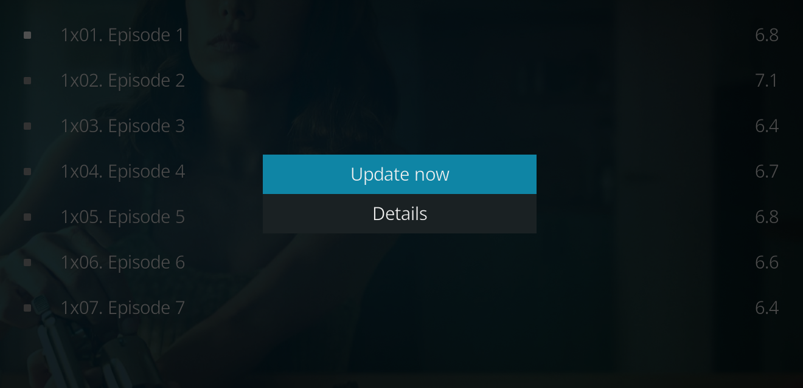
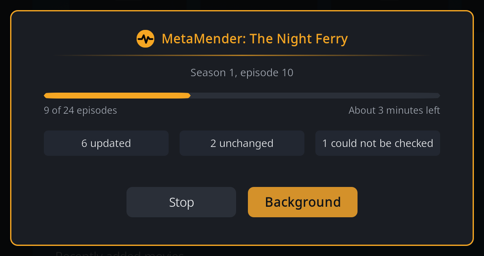

# Update now

**Update now** refreshes one item straight away, without waiting for the next
scan: useful right after you added a new episode, fixed a scrape, or changed a
setting and want to see the result.

## Where to find it

In your library, open the context menu of a movie, TV show, season, episode
or movie set (long-press OK on a remote, or the C key or right mouse button) and choose
**MetaMender > Update now**.

The **MetaMender** submenu also has **Details**; see
[the Details window](details.md). Right after installing MetaMender the
submenu is not there yet; it appears once Kodi has been restarted.

## What it does

Update now checks every field MetaMender manages for that item, even fields
that are settled or not due yet. It follows the same rules as a scan: values
from an NFO file and fields you [locked](details.md#restore-original-and-the-lock)
are left alone, and it fills in the same languages. It does not move the
item's normal refresh schedule: the next scheduled check stays where it was.
It also checks at once whether the item's local art files still exist, so
art whose file you deleted is filled straight away when a site has an image
for it.

- **A movie or an episode** is refreshed at once. A notification says
  **Updated**, **No changes**, or **Could not check now** when a site did not
  answer (the item is then checked again on its normal schedule). When Kodi
  lists the item's video file twice and MetaMender updates the other entry,
  it says so instead of **No changes**: use Update now on that other entry.
- **A TV show** refreshes the show itself, its season posters and every
  episode in it.
- **A season** refreshes its poster and every episode of that season.
- **A movie set** refreshes the set itself (its name, plot and art), not its
  movies. First it merges the set's duplicates: movies of the set's TMDB
  collection that sit in a duplicate set are moved into it (see
  [Duplicate sets](libraries.md#duplicate-sets)). On a duplicate, Update now
  merges it into the set MetaMender manages and refreshes that set. A
  notification says **Updated** when the set changed or a movie moved.
  For a set MetaMender leaves alone, nothing changes and the notification
  says **MetaMender leaves this set alone; Details says why**: its
  [Details window](details.md#a-set-metamender-leaves-alone) gives the
  reason.

Season posters are only refreshed in a library with **Posters** ticked, and
only for a show whose TMDB id MetaMender knows; a season of a show without
one is left as it is.

## Following a show or season

For a show or a season a window shows the progress: the season poster or
episode it is working on, how many are done, an estimate of the time left, and how many episodes were
updated, unchanged, or could not be checked.

- **Background** closes the window and lets the refresh carry on, with a small
  progress bar in the corner of the screen. Choose Update now again on the same
  show (or one of its seasons or episodes) to bring the window back.
- **Stop** stops after the episode in progress. Episodes already done keep
  their updates.

In the Videos window every change makes Kodi reload the list behind the
window, and while it reloads Kodi does not respond to the remote. So while you
are pressing keys Update now pauses its changes and carries on two seconds
after your last press. On a slow device or a large list your first press can
still be missed; press again and it is answered. The same pause keeps the list
still while you browse after choosing Background.

When it ends, a notification sums it up, for example "Updated: The Night
Ferry, 6 of 24 changed".

Update now only works in the [libraries you included](libraries.md). On an
item in a library that is left out, or in no library, it changes nothing and
a notification says the library is not included.

If fanart.tv refuses the key, a second notification says so and whether it
was your personal key; art that needs fanart.tv waits. See
[Personal fanart.tv API key](settings.md#fanarttv).

Only one scan runs at a time. If a background scan is busy, Update now says
**A scan is already running**; try again when it has finished.
