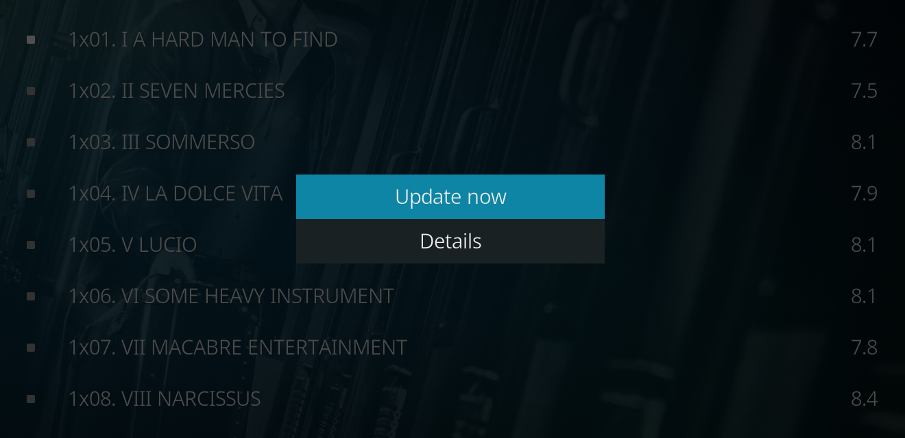
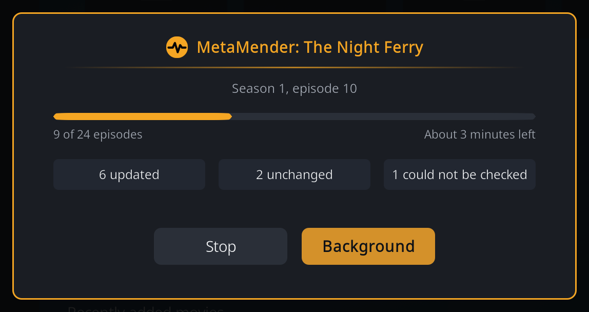

# Update now

**Update now** refreshes one item straight away, without waiting for the next
scan: useful right after you added a new episode, fixed a scrape, or changed a
setting and want to see the result.

## Where to find it

In your library, open the context menu of a movie, TV show, season or episode
(long-press OK on a remote, or the C key or right mouse button) and choose
**MetaMender > Update now**.

The **MetaMender** submenu also has **Details** for movies, shows and episodes;
see [the Details window](details.md).

## What it does

Update now checks every field MetaMender manages for that item, even fields
that are settled or not due yet. It follows the same rules as a scan: values
from an NFO file and fields you [locked](details.md#restore-original-and-the-lock)
are left alone, and it fills in the same languages. It does not move the
item's normal refresh schedule: the next scheduled check stays where it was.

- **A movie or an episode** is refreshed at once. A notification says
  **Updated**, **No changes**, or **Could not check now** when a site did not
  answer (the item is then tried again at the next scan).
- **A TV show** refreshes the show itself and every episode in it.
- **A season** refreshes every episode of that season.

## Following a show or season

For a show or a season a window shows the progress: the episode it is working
on, how many are done, an estimate of the time left, and how many episodes were
updated, unchanged, or could not be checked.

- **Background** closes the window and lets the refresh carry on, with a small
  progress bar in the corner of the screen. Choose Update now again on the same
  show (or one of its seasons or episodes) to bring the window back.
- **Stop** stops after the episode in progress. Episodes already done keep
  their updates.

When it ends, a notification sums it up, for example "Updated: The Night
Ferry, 6 of 24 changed".

Only one scan runs at a time. If a background scan is busy, Update now says
**A scan is already running**; try again when it has finished.
