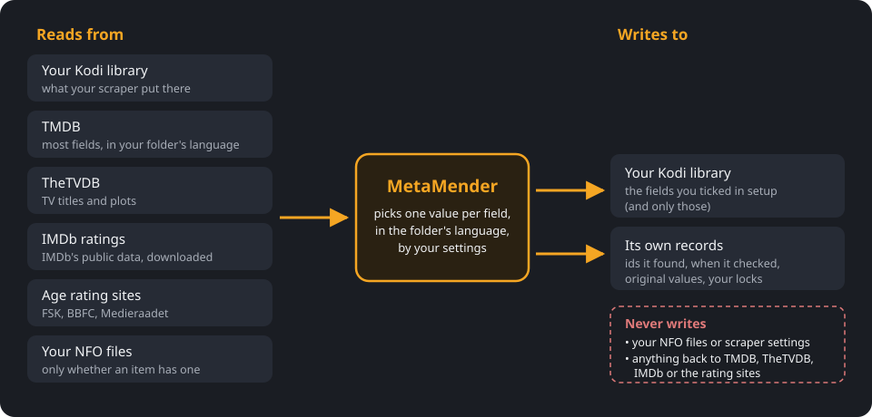

# Where your data comes from

This page explains where MetaMender gets each value, where it puts it, and
what it never touches. The short version is the picture; the table and the
examples below fill in the details.

## The big picture

**MetaMender reads from:**

- **Your Kodi library**: the values your scraper stored, and the ids it found
  (TMDB, TheTVDB, IMDb).
- **TMDB** (The Movie Database): most fields, in the language of the folder an
  item is in.
- **TheTVDB**: TV show and episode titles and plots.
- **IMDb's ratings**, from IMDb's public data, which the IMDb Ratings module
  downloads and keeps up to date on your device.
- **The FSK, BBFC and Medieraadet websites**, for age ratings.
- **Your NFO files**, but only to see whether an item has one; MetaMender does
  not read what is in it.

**MetaMender writes to:**

- **Your Kodi library**, and only the fields you ticked in
  [setup](setup.md#4-what-to-fill).
- **Its own records**, kept in the add-on's data folder: the ids it found,
  when it checked each field and when the next check is due, the value a field
  had before MetaMender first changed it, and the fields you locked.

**MetaMender never:**

- changes or creates NFO files, or changes your scraper or its settings;
- sends anything about your library to TMDB, TheTVDB, IMDb or the rating
  sites, other than the lookups themselves (an id or a title to look up);
- adds ids it found to Kodi: they stay in its own records;
- overwrites a value of an item that has an NFO file, or a field you locked.

## Field by field

"Folder language" is the language of the folder the item is in (see
[setup](setup.md#2-library-language)); "fallback" is that folder's fallback
language, if it has one.

| Field | For | Asked, in order | When MetaMender writes |
|---|---|---|---|
| Rating and votes | Movies, shows, episodes | TMDB and IMDb, as **Rating source** says | Adds or refreshes its own TMDB and IMDb ratings beside your scraper's; your scraper's own ratings stay. Which one Kodi shows: see [Rating source](settings.md#source-priority). |
| Plot | Movies | TMDB in the folder language, then TMDB in the fallback | Replaces a different plot. The fallback only fills an empty plot. |
| Plot | Shows, episodes | TMDB and TheTVDB in the folder language (order: **Text source order**), then both in the fallback (**Fallback language order**) | As for movies. |
| Episode title | Episodes | As episode plots | As plots. A generic title such as "Episode 3" counts as no title: it is never written, and one in Kodi counts as empty. |
| Show or movie title | Shows, movies | TMDB (and TheTVDB for shows), folder language only | Only with **Show and movie titles** ticked, and only a title the site really has in that language. Never from the fallback language. |
| Tagline | Movies | TMDB, folder language | Replaces a different tagline. |
| Genre | Movies, shows | TMDB, folder language | Replaces a different genre list. |
| Director, writer | Movies, episodes | TMDB | Replaces a different value. |
| Studio, country | Movies | TMDB | Replaces a different value. |
| Runtime | Movies, episodes | TMDB | Replaces a different value. |
| First aired | Episodes | TMDB | Replaces a different date. |
| Trailer | Movies | TMDB | Replaces a different link. |
| Age rating | Movies, shows | TMDB for your country, your country's rating site, then other countries converted ([details](age-ratings.md#where-a-rating-comes-from)) | Fills an empty rating; replaces a rating from another country's system (switch off with **Replace incorrect certifications**). |

Every row has the same three exceptions:

- **An item with an NFO file** only gets its empty fields filled.
- **In a folder without a language**, the text fields (plot, titles, tagline,
  genre) are only filled when empty, because MetaMender cannot tell which
  language the existing text is in.
- **A locked field** is never written.

"Replaces a different value" only happens while a field is not yet settled; see
[how often a field is checked](scans.md#how-often-a-field-is-checked). Once
settled, MetaMender does not look at it again.

## How MetaMender knows which item it is

To look anything up, MetaMender needs the item's id at TMDB or TheTVDB:

- **The ids your scraper stored** are used first.
- **A missing id** is looked up through the ids Kodi does have, for example the
  TMDB id from an IMDb id.
- **An episode without ids** (common with the TVmaze scraper) is matched by its
  season and episode number, but only when the air date (within a day, and
  only if no other episode of that season aired the same day) or the title
  agrees. If neither agrees, MetaMender uses nothing from that site. If TMDB
  and TheTVDB point at different episodes, it uses neither.

A wrong match is worse than none: an episode with someone else's plot is
harder to notice than one with no plot. The [Details window](details.md#ids)
shows how each id was found.

## Two examples

### An episode plot

An episode in a Dutch folder with English as its fallback. Your scraper stored
an English plot. Plots are ticked in setup.

1. **Does the item have an NFO file?** No, so MetaMender may replace values.
2. **Is the plot locked?** No.
3. **Does the folder have a language?** Yes, Dutch.
4. **Is the plot due for a check?** It is the first check, so yes.
5. **TMDB in Dutch:** it has a Dutch plot. MetaMender writes it; the English
   plot is kept as the original, so you can restore it from the Details
   window.

Had TMDB had no Dutch plot, MetaMender would have asked TheTVDB in Dutch. Had
neither had one, the English fallback would not be used, because the field
already has a plot. It stays English until a Dutch plot appears.

### A movie's age rating

A movie in a Dutch library, scraped with "Rated PG-13". Age certifications are
ticked and the country is the Netherlands.

1. **Does the item have an NFO file?** No.
2. **Is the current rating in the Dutch system?** No, "Rated PG-13" is
   American. **Replace incorrect certifications** is on, so MetaMender looks
   for a Dutch rating.
3. **TMDB's Dutch rating:** none.
4. **A Dutch rating site:** MetaMender has none for the Netherlands.
5. **TMDB's ratings for other countries:** Belgium has none; Germany has
   `12`. Converted to Kijkwijzer that is `12`, so MetaMender writes `NL:12`.

Because it was converted, MetaMender checks the movie again every month for
about a year; once TMDB has a real Dutch rating, that one replaces `NL:12`.
