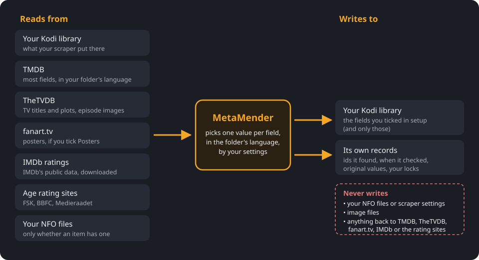

# Where your data comes from

This page explains where MetaMender gets each value, where it puts it, and
what it never touches. The short version is the picture; the table and the
examples below fill in the details.

## The big picture

**MetaMender reads from:**

- **Your Kodi library**: the values your scraper stored, and the ids it found
  (TMDB, TheTVDB, IMDb).
- **TMDB** (The Movie Database): most fields, in the language of the library
  an item is in.
- **TheTVDB**: TV show and episode titles and plots, and episode images
  when TMDB has no still for an episode.
- **fanart.tv**: movie, show and season posters, fanart and the other art
  types, for libraries with **Posters**, **Fanart** or **Other art** ticked
  (see [Image credits](#image-credits)).
- **IMDb's ratings**, from IMDb's public data, which the IMDb Ratings module
  downloads and keeps up to date on your device.
- **The FSK, BBFC and Medieraadet websites**, for age ratings.
- **Your NFO files**, but only to see whether an item has one; MetaMender does
  not read what is in it.

**MetaMender writes to:**

- **Your Kodi library**, and only in the libraries you included, the fields
  you ticked for that library (see [What to fill](libraries.md#what-to-fill)).
- **Its own records**, kept in the add-on's data folder: the ids it found,
  when it checked each field and when the next check is due, the value a field
  had before MetaMender first changed it, the art an item had when
  MetaMender first saw it, and the fields you locked.

**MetaMender never:**

- changes or creates NFO files, or changes your scraper or its settings;
- downloads images or writes image files: for art it only
  changes which image Kodi points at, and Kodi fetches the image;
- sends anything about your library to TMDB, TheTVDB, fanart.tv, IMDb or the
  rating sites, other than the lookups themselves (an id or a title to look
  up);
- adds ids it found to Kodi: they stay in its own records;
- overwrites a value of an item that has an NFO file (it only fills empty
  fields there), or a field you locked.

## Field by field

"Library language" is the language of the library the item is in (see
[Language](libraries.md#language)); "fallback" is that library's fallback
language, if it has one. The **bold** names are choices on the library's
page.

| Field | For | Asked, in order | When MetaMender writes |
|---|---|---|---|
| Rating and votes | Movies, shows, episodes | TMDB and IMDb, as **Which rating to show** says | Adds or refreshes its own TMDB and IMDb ratings beside your scraper's; your scraper's own ratings stay. Which one Kodi shows: see [Rating](libraries.md#rating). |
| Plot | Movies | TMDB in the library language, then TMDB in the fallback | Replaces a different plot. The fallback only fills an empty plot. |
| Plot | Shows, episodes | TMDB and TheTVDB in the library language (order: **Where plots and titles come from**), then both in the fallback (**Fallback language order**); see [Text sources](libraries.md#text-sources) | As for movies. |
| Episode title | Episodes | As episode plots | As plots. A generic title such as "Episode 3" counts as no title: it is never written, and one in Kodi counts as empty. |
| Show or movie title | Shows, movies | TMDB (and TheTVDB for shows), library language only; with **Keep the original title**, TMDB's original title | Only with **Show and movie titles** ticked, and only a title the site really has in that language. Never from the fallback language. With **Keep the original title**, the original title in its own language and script; an item without a TMDB id keeps its title. See [Titles](libraries.md#titles). |
| Tagline | Movies | TMDB, library language | Replaces a different tagline. |
| Genre | Movies, shows | TMDB, library language | Replaces a different genre list. |
| Director, writer | Movies, episodes | TMDB | Replaces a different value. |
| Studio, country | Movies | TMDB | Replaces a different value. |
| Runtime | Movies, episodes | TMDB | Replaces a different value. |
| First aired | Episodes | TMDB | Replaces a different date. |
| Trailer | Movies | TMDB | Replaces a different link. |
| Poster | Movies, shows, seasons | TMDB and fanart.tv (order: **Art source**): library language, then fallback, then a poster without text, then English for an empty poster only; see [Art](libraries.md#art) | Fills an empty or broken poster. Replaces a poster from TMDB or fanart.tv when a better one clearly leads; never a local file, a poster from another website, or one changed outside MetaMender. See [Posters and episode thumbs](libraries.md#posters-and-episode-thumbs). |
| Fanart | Movies, shows | TMDB backdrops and fanart.tv backgrounds (order: **Art source**): without text, then library language, then fallback, then English for an empty fanart only | As posters. Only the main fanart: the extra fanart (`fanart1` and so on) is never changed. |
| Clear logo | Movies, shows | TMDB logos and fanart.tv logos (order: **Art source**), as posters; an SVG logo from TMDB is skipped | As posters. |
| Key art | Movies, shows | A poster without text from TMDB or fanart.tv (order: **Art source**) | As posters. |
| Landscape, banner, clear art | Movies, shows | fanart.tv: library language, then fallback, then without text, then English for empty art only | As posters. |
| Disc art | Movies | As landscape | As posters. |
| Character art | Shows | As landscape | As posters. |
| Episode thumb | Episodes | TMDB's episode still, then TheTVDB's episode image | Replaces a frame grab, a broken link or an empty thumb. A local file, or an image from a website that MetaMender did not set, stays. |
| Age rating | Movies, shows | TMDB for your country, your country's rating site, then other countries converted ([details](age-ratings.md#where-a-rating-comes-from)) | Fills an empty rating; replaces a rating from another country's system (switch off with **Replace other countries' ratings**). |

Every row has the same three exceptions:

- **An item with an NFO file** only gets its empty fields filled. A value
  MetaMender filled there is its own, so it keeps refreshing it.
- **In a folder without a language** (only possible by editing
  MetaMender's `sources.json` file), the text fields (plot, titles, tagline,
  genre) and the art that can carry text (every art type but key art and
  the episode thumb) are only filled when empty, because MetaMender cannot
  tell which language the existing text is in. Again, what MetaMender filled
  it keeps refreshing.
- **A locked field** is never written.

"Replaces a different value" only happens while a field is not yet settled; see
[how often a field is checked](scans.md#how-often-a-field-is-checked). Once
settled, MetaMender does not look at it again.

## Image credits

MetaMender's art comes from these sites, and the
Details window names the site each one came from:

- **[TMDB](https://www.themoviedb.org)**: movie, show and season posters,
  movie and show fanart (backdrops), clear logos and key art, and episode
  stills.
- **[fanart.tv](https://fanart.tv)**: movie, show and season posters, and
  movie and show fanart and other art, for libraries with **Posters**,
  **Fanart** or **Other art** ticked. MetaMender asks fanart.tv only for an
  item whose art is due for a check and whose choice could depend on it,
  once per item for all its art types, and once per show and scan for the
  show and all its seasons.
- **[TheTVDB](https://thetvdb.com)**: episode images, for an episode TMDB has
  no still for.

The images stay on these sites: Kodi downloads each one when it shows it.

MetaMender uses its own fanart.tv key. A personal key of your own is
optional: see [Personal fanart.tv API key](settings.md#fanarttv). When
fanart.tv rejects the key or cannot be reached, art that needs it waits
until it works again, with nothing changed, and everything else carries on.

## How MetaMender knows which item it is

To look anything up, MetaMender needs the item's id at TMDB or TheTVDB:

- **The ids your scraper stored** are used first.
- **A missing id** is looked up through the ids Kodi does have, for example the
  TMDB id from an IMDb id.
- **An episode without ids** (common with the TVmaze scraper) is matched by its
  season and episode number, but only when the air date (within a day, and
  only if no other episode of that season aired the same day) or the title
  agrees. If neither agrees, MetaMender uses nothing from that site. If TMDB
  and TheTVDB point at different episodes, it uses neither.

A wrong match is worse than none: an episode with someone else's plot is
harder to notice than one with no plot. The [Details window](details.md#ids)
shows how each id was found.

## Two examples

### An episode plot

An episode in a Dutch library with English as its fallback. Your scraper
stored an English plot. Plots are ticked for that library.

1. **Does the item have an NFO file?** No, so MetaMender may replace values.
2. **Is the plot locked?** No.
3. **Does the library have a language?** Yes, Dutch.
4. **Is the plot due for a check?** It is the first check, so yes.
5. **TMDB in Dutch:** it has a Dutch plot. MetaMender writes it; the English
   plot is kept as the original, so you can restore it from the Details
   window.

Had TMDB had no Dutch plot, MetaMender would have asked TheTVDB in Dutch. Had
neither had one, the English fallback would not be used, because the field
already has a plot. It stays English until a Dutch plot appears.

### A movie's age rating

A movie in a Dutch library, scraped with "Rated PG-13". Age certifications are
ticked for that library and its country is the Netherlands.

1. **Does the item have an NFO file?** No.
2. **Is the current rating in the Dutch system?** No, "Rated PG-13" is
   American. **Replace other countries' ratings** is on, so MetaMender looks
   for a Dutch rating.
3. **TMDB's Dutch rating:** none.
4. **A Dutch rating site:** MetaMender has none for the Netherlands.
5. **TMDB's ratings for other countries:** Belgium has none; Germany has
   `12`. Converted to Kijkwijzer that is `12`, so MetaMender writes `NL:12`.

Because it was converted, MetaMender checks the movie again every month for
about a year; once TMDB has a real Dutch rating, that one replaces `NL:12`.
